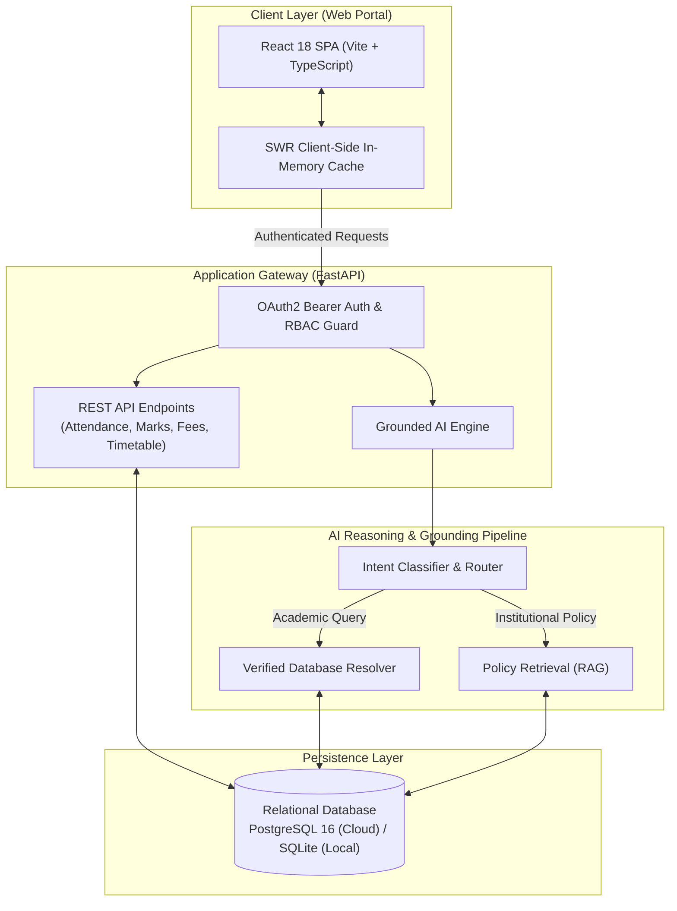
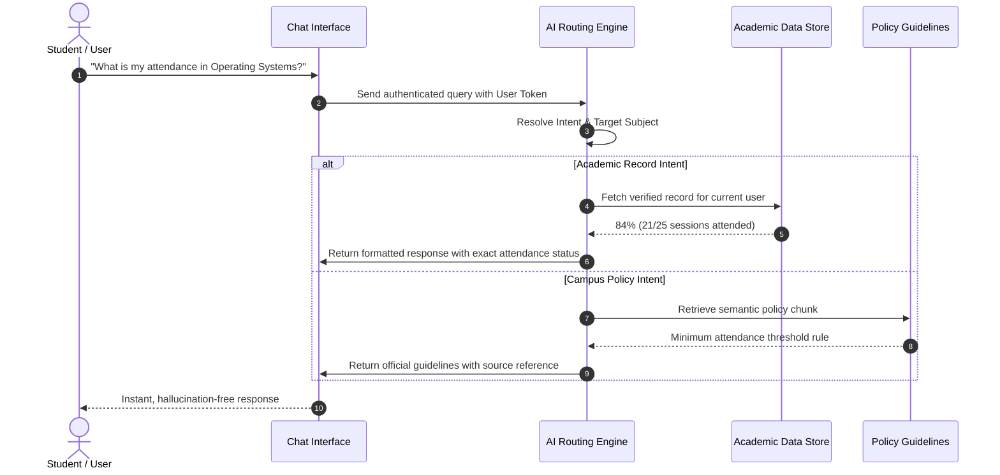

<div align="center">

# 🎓 CSIC — Cloud Student Information Chatbot

**An institutional academic management portal powered by a grounded conversational AI assistant.**

[](https://csic-orpin.vercel.app)
[](https://github.com/Akshitkumar23/CSIC/actions/workflows/ci.yml)
[](https://fastapi.tiangolo.com)
[](https://react.dev)
[](https://www.typescriptlang.org)
[](https://python.org)

<p align="center">
  <a href="#-about-the-project">About</a> •
  <a href="#-key-features">Features</a> •
  <a href="#-system-architecture">Architecture</a> •
  <a href="#-how-the-ai-works">AI Workflow</a> •
  <a href="#-demo-credentials">Demo Accounts</a> •
  <a href="#-quickstart">Quickstart</a> •
  <a href="#-verification">Testing</a>
</p>

</div>

---

## 📖 About the Project

**CSIC (Cloud-Based Student Information Chatbot)** modernizes campus academic operations by bringing student self-service into an intuitive, conversational interface.

Rather than navigating traditional, complex ERP menus, students can query their academic status—such as attendance percentage, exam grades, pending dues, lecture venues, and university circulars—directly in plain English. Every query is grounded through verified database records and institutional policy retrieval, ensuring **real-time accuracy with zero AI hallucinations**.

---

## ✨ Key Features

| Feature | Highlight |
|---|---|
| 🤖 **Grounded AI Assistant** | ChatGPT-style interface that extracts user intent, fetches verified database records, and cites university policies. |
| 📊 **Attendance Tracking** | Real-time visual attendance indicators with subject drill-down and automatic alerts below the 75% threshold. |
| 📝 **Examinations & Transcripts** | Instant semester-wise grade view, subject scores, and overall GPA calculations. |
| 💳 **Fee & Dues Management** | Transparent ledger of tuition and semester invoices with instantaneous simulated clearance. |
| 🗓️ **Smart Timetable** | Dynamic day-by-day weekly schedules with real-time highlights for current lectures and room allocations. |
| 📢 **Official Circulars** | Categorized notice board (Academic, Examinations, Events, Urgent) with fast text search. |
| 🛡️ **Role-Based Portals (RBAC)** | Strict boundary isolation across **Student**, **Faculty** (at-risk rosters), and **Administrator** controls. |
| ⚡ **Sub-100ms Transitions** | Built with an SWR in-memory caching engine and promise deduplication for smooth, flicker-free browsing. |

---

## 🏛️ System Architecture

The following diagram illustrates how CSIC separates the client presentation, secure API orchestration, AI reasoning layer, and relational persistence:



---

## 🔄 How the AI Works

Unlike standard LLM chatbots that risk generating made-up information, CSIC uses a **two-tier grounded pipeline** to keep answers 100% verified:



---

## 🛠️ Tech Stack

```text
Frontend   │ React 18 • TypeScript 5.5 • Tailwind CSS • Vite • Lucide Icons
Backend    │ FastAPI (Python 3.12) • OAuth2 / JWT • Pydantic v2 • Uvicorn
Database   │ PostgreSQL 16 (Cloud / Supabase) • SQLite (Local Zero-Config Dev)
AI Engine  │ Hybrid Intent Classifier • Direct Database Grounding • Policy RAG
Cloud & CI │ Vercel Multi-Service • Render Cloud • GitHub Actions CI/CD
```

---

## 👥 Demo Credentials

The portal features **1-Click Quick Login** buttons on the login screen, or you can use these accounts:

| Role | Name | Email | Password | Access Scope |
|---|---|---|---|---|
| **Student** | Akshit | `akshit@csic.edu` | `1234` | Personal attendance, marks, fees & AI chatbot |
| **Student** | Rashi | `rashi@csic.edu` | `1234` | Personal student records & timetable |
| **Student** | Vanshika | `vanshika@csic.edu` | `1234` | Personal student records & timetable |
| **Student** | Silki | `silki@csic.edu` | `1234` | Personal student records & timetable |
| **Faculty** | Rajesh Kumar | `rajesh.kumar@csic.edu` | `1234` | At-risk student monitoring & notices |
| **Admin** | Administrator | `admin@csic.edu` | `1234` | System analytics, student roster & announcements |

---

## 🚀 Quickstart

### Prerequisites
- **Python 3.12+**
- **Node.js 20+**

### ⚡ Option A: 1-Click Launcher (Windows)
Double-click `run_dev.bat` or run in PowerShell:
```powershell
.\run_dev.ps1
```
> *This automatically seeds the local database, launches the FastAPI backend at `http://localhost:8000`, and starts the Vite frontend at `http://localhost:5173`.*

---

### 💻 Option B: Manual Setup

1. **Clone the repository:**
   ```bash
   git clone https://github.com/Akshitkumar23/CSIC.git
   cd CSIC
   ```

2. **Start Backend:**
   ```bash
   # Set up virtual environment
   python -m venv venv
   source venv/bin/activate  # On Windows: venv\Scripts\activate
   pip install -r backend/requirements.txt

   # Seed local database & start FastAPI
   python database/init_db.py
   uvicorn backend.app.main:app --reload --port 8000
   ```

3. **Start Frontend:**
   ```bash
   cd frontend
   npm install
   npm run dev
   ```

4. **Access the Portal:**
   - 🌐 **Web Portal:** `http://localhost:5173`
   - 📑 **Interactive API Docs (Swagger UI):** `http://localhost:8000/docs`

---

## 🧪 Verification

Run the automated test suite locally to verify full system integrity:

```bash
# 1. Backend API, Security & AI tests (111 tests)
python -m pytest backend/tests -v

# 2. Database schema initialization & verification
python database/init_db.py

# 3. Frontend production build & type checks
cd frontend && npm.cmd run build
```

---

## 📄 License

Developed as an educational open-source capstone project for the **Cloud-Based Student Information Chatbot (CSIC)**.
