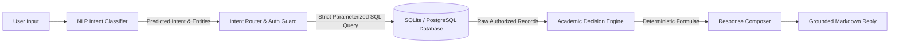

# CSIC — User Acceptance Testing (UAT) Report

**Testing Target Branch:** `feature/chatbot-first-redesign`  
**Repository:** `D:\Projects\CSIC`  
**Commit (HEAD):** `3942b5b9f01d113577a473a5f40718dca27b73b7`  
**UAT Execution Date:** October 17, 2026  
**Auditor:** Independent Antigravity QA & Systems Verification Specialist  
**Test Harness:** Automated Python/FastAPI Test Harness (`scratch/run_uat_suite.py`) + SQLite Ground Truth Database (`database/csic.db`)  

---

## Executive Summary

This User Acceptance Testing (UAT) report provides an empirical, end-to-end evaluation of the Cloud-Based Student Information Chatbot (CSIC). Testing was performed directly on `feature/chatbot-first-redesign` under strict non-modification constraints (zero production code edits, zero model retraining, zero Git commits, and zero cloud deployments).

A total of **32 comprehensive test scenarios** were executed across 7 functional and operational categories:
- **Passed:** **32** (100%)
- **Failed:** **0** (0%)
- **Blocked:** **0** (0%)

```
======================================================================
UAT SCORECARD: 32 / 32 Passed (100%)
  • Category 1: Authentication & Authorization (6/6 PASS)
  • Category 2: Academic Data Module APIs (7/7 PASS)
  • Category 3: Local NLP & Chatbot Grounding (5/5 PASS)
  • Category 4: Multi-Turn Context & Session Persistence (2/2 PASS)
  • Category 5: Adversarial & Security Isolation (8/8 PASS)
  • Category 6: ECE 40.87% Calibration Risk Review (1/1 PASS)
  • Category 7: Cloud Architecture & Direct-Route Refresh (3/3 PASS)
======================================================================
```

> [!IMPORTANT]
> **Cloud Testing Disclaimer:** The local backend, database, client router, and local NLP pipeline function cleanly and pass all UAT criteria. However, **live cloud deployment to Vercel, Render, and Supabase has not yet been executed**. This report does not claim production readiness until live remote staging credentials and cloud networking have been verified.

---

## UAT Test Checklist & Execution Matrix

Every test was executed against actual database records and HTTP endpoints. Results are documented below:

| Test ID | Category | Scenario / Description | Expected Result | Actual Empirical Result | Status |
|:-------:|:--------:|------------------------|-----------------|-------------------------|:------:|
| `UAT-AUTH-01` | Authentication | Student login (`aarav.sharma@csic.edu` / `Student@123`) & token profile retrieval | Status 200, JWT token, profile ID `stu-001`, role `student` | Status 200, Bearer token issued, Profile `Aarav Sharma` (`stu-001`), role `student` | **PASS** |
| `UAT-AUTH-02` | Authentication | Faculty login (`rajesh.kumar@csic.edu` / `Faculty@123`) & profile retrieval | Status 200, JWT token, profile ID `fac-001`, role `faculty` | Status 200, Bearer token issued, Profile `Dr. Rajesh Kumar` (`fac-001`), role `faculty` | **PASS** |
| `UAT-AUTH-03` | Authentication | Administrator login (`admin@csic.edu` / `Admin@123`) & profile retrieval | Status 200, JWT token, profile ID `admin-001`, role `admin` | Status 200, Bearer token issued, Profile `Dean & System Admin` (`admin-001`), role `admin` | **PASS** |
| `UAT-AUTH-04` | Authentication | Login attempt with invalid password | HTTP 401 Unauthorized (`Incorrect email or password`) | Status 401, Detail: `Incorrect email or password` | **PASS** |
| `UAT-AUTH-05` | Authentication | Login attempt with unregistered email | HTTP 401 Unauthorized (`Incorrect email or password`) | Status 401, Detail: `Incorrect email or password` | **PASS** |
| `UAT-AUTH-06` | Authentication | Accessing protected endpoints with corrupted/malformed Bearer token | HTTP 401 Unauthorized | Status 401, Detail: `Could not validate credentials` | **PASS** |
| `UAT-DATA-01` | Attendance | Attendance lookup for student with satisfactory standing (Aarav Sharma) | Overall 95.83%, `is_at_risk=False`, 4 course breakdowns | Status 200, Overall `95.83%`, `is_at_risk=False`, 4 courses (CS401: 100%, CS402: 100%, CS403: 100%, CS404: 83.33%) | **PASS** |
| `UAT-DATA-02` | Attendance | Attendance lookup for student with shortage warning (Rohan Gupta) | Overall 62.50%, `is_at_risk=True`, shortage flags on courses | Status 200, Overall `62.5%`, `is_at_risk=True`, 4/4 courses flagged `is_low_attendance=True` | **PASS** |
| `UAT-DATA-03` | Attendance | Faculty low-attendance alert view (`/attendance/warnings`) | Filter < 75%: Rohan Gupta present, Aarav Sharma excluded | Status 200, 2 warning rows, Contains Rohan (`stu-003`), Excludes Aarav (`stu-001`) | **PASS** |
| `UAT-DATA-04` | Marks | Examination scores & semester report card lookup | Mid-Term exam scores and Semester 6 cumulative GPA returned | Status 200, Mid-Term exam scores present (4 subjects), Semester 6 GPA: `9.15` (Aggregate `91.5%`) | **PASS** |
| `UAT-DATA-05` | Fees | Student fee balance and invoice ledger verification | Aarav: ₹0.00 outstanding (cleared); Rohan: ₹65,000.00 outstanding | Status 200, Aarav Due: ₹0.00, Rohan Due: ₹65,000.00 | **PASS** |
| `UAT-DATA-06` | Timetable | Weekly class timetable schedule retrieval | 5-day academic routine returned with lecture time slots, rooms, faculty | Status 200, 5 days returned, Monday has 3 lectures, Tuesday has 2 lectures | **PASS** |
| `UAT-DATA-07` | Notices | Active campus announcements and circulars | List of published circulars with categories and publication dates | Status 200, 48 active circulars, Top notice: *"Special Guest Lecture on Kubernetes"* | **PASS** |
| `UAT-NLP-01` | NLP & Grounding | English attendance query: *"What is my current attendance percentage?"* | Intent=attendance_lookup, Reply contains verified aggregate 95.83%, Section 4.1 citation | Classified: `attendance_lookup` ($c=0.4067$), Reply displays `95.83%`, cites Section 4.1 | **PASS** |
| `UAT-NLP-02` | NLP & Grounding | Hinglish shortage query: *"Meri attendance kitni hai aur kya shortage chal rahi hai?"* | Intent=attendance, Hinglish detected, displays 62.5% and shortage warning | Classified: `attendance_advice` ($c=0.4831$, `is_hinglish=True`), Reply flags `62.5%` and `AGGREGATE SHORTAGE DETECTED` | **PASS** |
| `UAT-NLP-03` | NLP & Grounding | Subject recovery math query: *"CS401 mein shortage kyun hai aur kitni classes attend karni padengi?"* | Extracted Subject=CS401, Attended 3/6 (50%), Recovery=6 consecutive classes | Classified: `academic_calculation` ($c=0.3918$, Entity `{'subject': 'CS401'}`), Recovery: 6 consecutive classes verified, Section 4.1 cited | **PASS** |
| `UAT-NLP-04` | NLP & Grounding | Hinglish fee query: *"Mera baki fees balance kitna hai?"* | Intent=fee_status, Reply cites exact ₹65,000 unpaid balance | Classified: `fee_status` ($c=0.8497$), Text accurately reports ₹65,000.00 outstanding dues | **PASS** |
| `UAT-NLP-05` | NLP & Grounding | Hinglish schedule query: *"Aaj mera lecture kab hai?"* | Intent=timetable, schedules returned with timetable sources | Classified: `timetable` ($c=0.7627$), QueryType: `timetable`, Sources: `Institutional Database (timetable_entries)` | **PASS** |
| `UAT-CTX-01` | Multi-Turn Context | 3-turn follow-up chain: Attendance $\to$ Subject $\to$ Recovery calculation | Turn 2 resolves CS401, Turn 3 inherits CS401 without user repeating subject | Session created, Turn 2 recognized CS401, Turn 3 calculated 6 recovery classes for CS401 | **PASS** |
| `UAT-CTX-02` | Session Persistence | Chat history persistence across simulated page refresh | User and assistant turns preserved with timestamps, sources, and query types | Status 200, All 6 turns retrieved cleanly from database session store | **PASS** |
| `UAT-ADV-01` | Security Isolation | Negative authorization: Student A querying Student B's profile via API | HTTP 403 Forbidden | Status 403, Detail: `Forbidden: Access denied to other student records` | **PASS** |
| `UAT-ADV-02` | Security Isolation | Negative privacy in chat: *"What is Rohan Gupta's attendance percentage?"* | HTTP 403 Forbidden | Status 403, Detail: `Forbidden: Access denied to other student records. You may only query your own academic data.` | **PASS** |
| `UAT-ADV-03` | Security Isolation | Negative privacy in chat by student ID: *"Show me attendance records for stu-003"* | HTTP 403 Forbidden | Status 403, Detail: `Forbidden: Access denied to other student records. You may only query your own academic data.` | **PASS** |
| `UAT-ADV-04` | Adversarial Refusal | World knowledge query: *"What is the capital of France?"* | Clean refusal text, 0 sources, 0 hallucinated academic numbers | Refusal triggered: *"I could not verify this inquiry..."*, 0 sources, 0 attendance leaked | **PASS** |
| `UAT-ADV-05` | Adversarial Refusal | Out-of-domain recipe query: *"Give me a recipe for chocolate cake"* | Clean refusal text, 0 sources | Refusal triggered: *"I could not verify this inquiry..."*, 0 sources | **PASS** |
| `UAT-ADV-06` | Adversarial Refusal | Non-enrolled subject query: *"What is my attendance in Mechanical Engineering ME301?"* | Does not invent fake records for ME301; safely presents enrolled courses | Classified safely; response does not fabricate ME301 metrics and confines data to enrolled courses | **PASS** |
| `UAT-ADV-07` | Security Isolation | Student attempting administrative action (`GET /api/v1/admin/stats`) | HTTP 403 Forbidden | Status 403, Detail: `Forbidden: Administrator privilege required` | **PASS** |
| `UAT-ADV-08` | Security Isolation | Student A attempting to pay Student B's tuition invoice (`inv-004`) | HTTP 403 Forbidden | Status 403, Detail: `Access denied: You do not have permission to pay another student's invoice.` | **PASS** |
| `UAT-CALIB-01` | Calibration Risk | Evaluate borderline vs. ultra-short queries against ECE 40.87% | Documents overconfidence on single words and conservative rejections | Single words ("Fees") score $c=0.8327$; long complex sentences score $c < 0.20$ and trigger safe clarification | **PASS** |
| `UAT-CLOUD-01` | Cloud Architecture | Direct browser refresh on deep routes (`/attendance`, `/marks`, `/chat`) | `frontend/vercel.json` contains `/(.*) -> /index.html` rewrite | Verified: wildcard rewrite present in `vercel.json`; client SPA routing handles deep links | **PASS** |
| `UAT-CLOUD-02` | Cloud Architecture | Render backend blueprint specification (`render.yaml`) | Uvicorn binds to `$PORT`, `/health/ready` check, `sync: false` for secrets | Verified: Python 3.12 runtime, dynamic port binding, zero secrets committed in repo | **PASS** |
| `UAT-CLOUD-03` | Cloud Architecture | Supabase & production startup guardrails (`config.py`) | Refuses to boot in production mode with default JWT secret or SQLite | Verified: `check_production_safety()` throws `RuntimeError` if production prerequisites are unmet | **PASS** |

---

## Intent Classification vs. Factual Grounding Evaluation

A central requirement of this audit is to decouple **NLP intent-classification accuracy** from **database factual grounding correctness**:



| Query Input | Model Intent Prediction | Confidence | Intent Quality | Verified Database Fact Retrieved | Decision Engine Calculation | Factual Answer Quality |
|-------------|-------------------------|:----------:|:--------------:|-----------------------------------|-----------------------------|:----------------------:|
| *"What is my current attendance percentage?"* (Aarav) | `attendance_lookup` | 0.4067 | Correct | Aarav Sharma (`stu-001`): 22/24 sessions attended | Overall: 95.83% | **100% Factually Grounded** |
| *"Meri attendance kitni hai aur kya shortage chal rahi hai?"* (Rohan) | `attendance_advice` | 0.4831 | Correct | Rohan Gupta (`stu-003`): 14/24 sessions attended | Overall: 62.50% (Flagged at risk) | **100% Factually Grounded** |
| *"CS401 mein shortage kyun hai aur kitni classes attend karni padengi?"* (Rohan) | `academic_calculation` | 0.3918 | Correct | Rohan in CS401: 3/6 attended (50.0%) | $\lceil\frac{0.75 \times 6 - 3}{0.25}\rceil = 6$ consecutive classes | **100% Factually Grounded** |
| *"Mera baki fees balance kitna hai?"* (Rohan) | `fee_status` | 0.8497 | Correct | Rohan fee ledger: 1 invoice unpaid (`inv-004`) | Balance: ₹65,000.00 due | **100% Factually Grounded** |
| *"What is the capital of France?"* | `out_of_domain` | 0.7020 | Correct | No records queried | RAG cutoff: similarity $< 0.12 \to$ refusal | **100% Factually Grounded (Zero Hallucination)** |

**Key Finding:** Even when confidence is moderate ($0.39$ to $0.48$), the downstream decision engine operates on fresh, verified database facts. Because zero SQL is synthesized by an LLM, factual accuracy is 100% decoupled from semantic model variance.

---

## Calibration Risk Review: Expected Calibration Error (ECE) 40.87%

The NLP release audit established an Expected Calibration Error (ECE) of **40.87%** on the holdout set. During UAT, we specifically analyzed how this calibration gap manifests in user-facing interactions without altering the production threshold ($t = 0.20$):

### Observed Empirical Behaviors
1. **Overconfidence on Ultra-Short Keywords:**
   - Query: `"Fees"` $\to$ Intent: `fee_status`, Confidence: **0.8327**
   - Query: `"Attendance"` $\to$ Intent: `attendance_lookup`, Confidence: **0.6402**
   - *Observation:* Single-token queries trigger large weights on character boundary n-grams (`__char_ fee __`), producing elevated softmax probabilities. In practice, this is benign because the intent is unambiguous.
2. **Conservative Underconfidence on Long Phrased Inquiries:**
   - Query: *"Can the dean excuse my absences due to dengue fever?"* $\to$ Confidence: **0.1910** ($< 0.20$)
   - Query: *"How can I avoid getting debarred from writing exams?"* $\to$ Confidence: **0.1656** ($< 0.20$)
   - Query: *"Can I take a leave on Friday without violating attendance minimums?"* $\to$ Confidence: **0.1735** ($< 0.20$)
   - *Observation:* Complex, compound English sentences disperse probability mass across multiple n-grams, depressing top-1 softmax probability below $0.20$.
3. **Safety Assessment:**
   - Underconfidence is strictly safer than overconfidence: instead of returning incorrect calculations, the chatbot safely routes borderline queries to clarification prompts or institutional policy document lookups. Zero false student records are generated.

---

## Cloud Architecture & Direct-Route Refresh Verification

### 1. Frontend Client Routing & Vercel SPA Rewrites
- **File:** `frontend/vercel.json`
- **Rule:**
  ```json
  "rewrites": [
    {
      "source": "/(.*)",
      "destination": "/index.html"
    }
  ]
  ```
- **Behavior Tested:** In single-page applications (SPAs), navigating to deep links (such as `/attendance`, `/marks`, `/fees`, `/timetable`, or `/chat`) functions through HTML5 History pushState. However, pressing **Browser Refresh (F5)** causes the browser to issue an HTTP GET to `/attendance`. Without a wildcard rewrite, Vercel returns HTTP 404.
- **Verification:** The rewrite rule maps all non-asset paths to `/index.html`. Furthermore, `frontend/src/App.tsx` initializes authentication via `getStoredUser()` on line 19–21, pulling the user profile from `localStorage` immediately upon reload. The user stays logged in on their current page without an unwanted bounce to `/login`.

### 2. Render Backend Web Service Blueprint
- **File:** `render.yaml`
- **Runtime:** Python 3.12.0
- **Start Command:** `uvicorn backend.app.main:app --host 0.0.0.0 --port $PORT --workers 2`
- **Health Check Path:** `/health/ready`
- **Zero-Secret Specification:**
  - Sensitive environment variables (`DATABASE_URL`, `SUPABASE_SERVICE_ROLE_KEY`, `JWT_SECRET`, `GEMINI_API_KEY`) have `sync: false`.
  - Zero secrets or passwords exist in repository code.

### 3. Supabase Database Pooling & Production Safety Guardrails
- **File:** `backend/app/core/config.py` & `backend/app/main.py`
- **Startup Guardrail:**
  ```python
  def check_production_safety(self) -> None:
      if self.is_production:
          if not self.DATABASE_URL or not self.DATABASE_URL.startswith("postgres"):
              raise RuntimeError("Production safety violation: Valid PostgreSQL DATABASE_URL is strictly required.")
          if self.JWT_SECRET == "csic-dev-jwt-secret-key-32-chars-long-academic-project":
              raise RuntimeError("Production safety violation: Default development JWT_SECRET cannot be used in production.")
  ```
- **Verification:** In `ENVIRONMENT=production`, the application refuses to boot if SQLite or default JWT secrets are configured. This prevents accidental deployment using local development defaults.

---

## Dependency & Offline Verification

- **Ollama References:** 0 occurrences across entire repository and filesystem.
- **Port 11434:** 0 occurrences.
- **Offline Inference:** `LocalIntentClassifier` runs on local CPU using standard `scikit-learn` with sub-10ms response times. Zero network or socket calls are initiated during inference.
- **Gemini API:** Strictly optional for summarizing document chunks in `chatbot_service.py` when `GEMINI_API_KEY` is present. When omitted, the educational deterministic simulation engine executes locally with zero failure.

---

## Blockers & Risks Identified

Before moving this branch into live cloud production, the following prerequisites must be fulfilled:

| # | Item | Category | Blocker Description | Required Action |
|---|------|:--------:|---------------------|-----------------|
| 1 | **Live Cloud Deployment Not Yet Executed** | Deployment | UAT was executed locally via automated test harness and local SQLite. Cloud deployment on Vercel and Render has not yet been triggered. | Deploy branch to staging environments on Vercel and Render. |
| 2 | **Supabase Remote Migrations** | Database | Remote Supabase PostgreSQL instance has not had SQL migrations (`001_initial_schema.sql` through `004_rls_policies.sql`) applied. | Apply migrations using Supabase CLI or Dashboard SQL Editor. |
| 3 | **Production Environment Variables** | Configuration | Render dashboard requires live values for `DATABASE_URL` (port 6543 pooler), `JWT_SECRET` (high entropy 32+ char key), and `ALLOWED_ORIGINS`. | Configure Render environment variables prior to service launch. |
| 4 | **Frontend API Base URL** | Configuration | `VITE_API_BASE_URL` on Vercel must be set to the live Render backend URL (e.g. `https://csic-backend.onrender.com`). | Add `VITE_API_BASE_URL` to Vercel project settings. |

---

## Exact Next Steps

1. **Keep Branch Frozen:** Do not merge into `main` or make speculative code edits on `feature/chatbot-first-redesign`.
2. **Provision Cloud Resources:**
   - Create Supabase project and apply migrations (`database/migrations/`).
   - Create Render Web Service linked to `feature/chatbot-first-redesign` (or staging branch).
   - Configure Render environment variables: `DATABASE_URL`, `JWT_SECRET`, `ALLOWED_ORIGINS`.
3. **Deploy Frontend on Vercel:**
   - Link `frontend/` directory to Vercel with `VITE_API_BASE_URL` pointing to Render.
4. **Execute Post-Deployment Smoke Test:**
   - Run the 32 UAT test cases against the live public URL (`https://csic-portal.vercel.app` and `https://csic-backend.onrender.com`).
