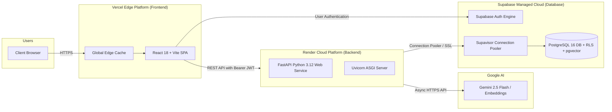

# Cloud Deployment & Infrastructure Guide

## 1. Cloud Architecture Overview

The system utilizes an optimized, cloud-native decoupled architecture:



---

## 2. Logical Environments

| Environment | Purpose | Database | Frontend URL | Backend URL |
| :--- | :--- | :--- | :--- | :--- |
| **Local Development** | Developer workstation, rapid iteration, unit tests | Local PostgreSQL or Supabase Local Branch | `http://localhost:5173` | `http://localhost:8000` |
| **Staging / Preview** | Automated PR verification via GitHub Actions / Vercel preview | Isolated preview database instance | Vercel Git Branch Preview | Render Staging Service |
| **Production Demonstration** | Live academic demonstration and evaluation | Supabase Managed Cloud Production | `https://csic-portal.vercel.app` | `https://csic-backend.onrender.com` |

---

## 3. Deployment Configurations

### 3.1 Backend Deployment (Render)
- **Environment:** `Python 3.12`
- **Build Command:** `pip install -r requirements.txt`
- **Start Command:** `uvicorn backend.app.main:app --host 0.0.0.0 --port $PORT --workers 2`
- **Health Check Path:** `/health/ready`
- **Environment Variables:**
  - `PORT`: Automatically injected by Render.
  - `SUPABASE_URL`: Supabase project URL (`https://<project-ref>.supabase.co`).
  - `SUPABASE_SERVICE_ROLE_KEY`: Secret service-role key for administrative initialization.
  - `DATABASE_URL`: Transaction connection pooler URI (`postgresql://postgres.<ref>:<password>@aws-0-...pooler.supabase.com:6543/postgres?sslmode=require`).
  - `GEMINI_API_KEY`: Google GenAI API key.
  - `ALLOWED_ORIGINS`: Comma-separated list of allowed frontend origins for CORS.

### 3.2 Frontend Deployment (Vercel)
- **Framework Preset:** `Vite`
- **Build Command:** `npm run build`
- **Output Directory:** `dist`
- **SPA Rewrites (`vercel.json`):**
  ```json
  {
    "rewrites": [
      { "source": "/(.*)", "destination": "/index.html" }
    ]
  }
  ```
- **Environment Variables:**
  - `VITE_API_BASE_URL`: Live Render backend URL.
  - `VITE_SUPABASE_URL`: Supabase project URL.
  - `VITE_SUPABASE_ANON_KEY`: Public anonymous Supabase key (safe for browser exposure).

---

## 4. Connection Pooling and Database Scaling
Supabase utilizes **Supavisor** for high-efficiency connection pooling:
- **Transaction Mode (Port 6543):** Used by FastAPI worker processes for short-lived stateless API transactions. Prevents connection exhaustion when concurrent student requests spike.
- **Session Mode (Port 5432):** Used during database migration runs (`supabase db push`) where schema changes and prepared statements require continuous sessions.

---

## 5. Security & Zero Secret Exposure
- All private keys (`SUPABASE_SERVICE_ROLE_KEY`, `GEMINI_API_KEY`, `DATABASE_URL` with password) exist strictly as encrypted environment variables in Render and GitHub Actions repository secrets.
- The React client build bundle is audited to ensure zero private tokens exist in generated JS chunks.

---

## 6. Official Pricing & Cloud Cost Considerations
- **Vercel Hobby Plan:** \$0 / month (Unlimited personal projects, 100GB bandwidth, automated preview deployments).
- **Render Free Tier / Starter:** \$0 - \$7 / month (Free tier spins down after 15 min inactivity; warm-up probe configured via `/health/live`).
- **Supabase Free Tier:** \$0 / month (Up to 500MB database, 50,000 monthly active users, daily automated backups, 1GB storage).
- **Google Gemini API Free Tier:** 15 Requests Per Minute (RPM), 1,000,000 Tokens Per Minute (TPM), free for educational testing.
- **Total Project Cost:** **\$0.00** (100% capable on official educational and free tiers).
