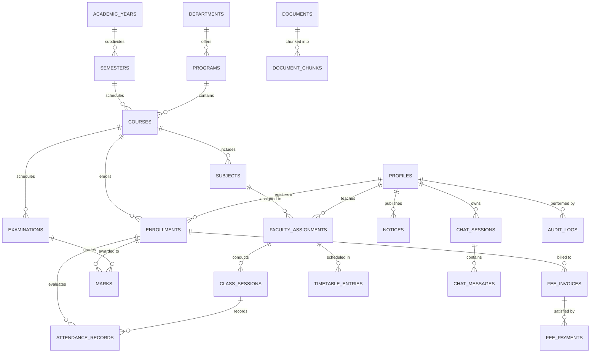

# Database Design Specification

## 1. Schema Overview & Normalization Strategy
The database is designed in Third Normal Form (3NF) to eliminate data redundancy and maintain referential integrity. All timestamps utilize `TIMESTAMPTZ`, currencies utilize `NUMERIC(10,2)`, and academic marks/percentages utilize `NUMERIC(5,2)`.

### Entity-Relationship Diagram

---

## 2. Table Specifications & Constraints

### 2.1 Identity and Organization
- **`profiles`**: Linked 1:1 with Supabase Auth `auth.users(id)`.
  - `id UUID PRIMARY KEY REFERENCES auth.users(id) ON DELETE CASCADE`
  - `role VARCHAR(20) NOT NULL CHECK (role IN ('student', 'faculty', 'admin'))`
  - `email VARCHAR(255) NOT NULL UNIQUE`
  - `full_name VARCHAR(150) NOT NULL`
  - `phone VARCHAR(20)`
  - `avatar_url TEXT`
  - `is_active BOOLEAN NOT NULL DEFAULT TRUE`
  - `created_at TIMESTAMPTZ NOT NULL DEFAULT NOW()`
  - `updated_at TIMESTAMPTZ NOT NULL DEFAULT NOW()`

- **`departments`**: Academic units (e.g., Computer Science, Electrical).
  - `id UUID PRIMARY KEY DEFAULT gen_random_uuid()`
  - `code VARCHAR(20) NOT NULL UNIQUE`
  - `name VARCHAR(150) NOT NULL`
  - `head_of_department_id UUID REFERENCES profiles(id) ON DELETE SET NULL`
  - `created_at TIMESTAMPTZ NOT NULL DEFAULT NOW()`

- **`programs`**: Degrees offered by departments (e.g., B.Tech CSE, M.Tech AI).
  - `id UUID PRIMARY KEY DEFAULT gen_random_uuid()`
  - `department_id UUID NOT NULL REFERENCES departments(id) ON DELETE RESTRICT`
  - `code VARCHAR(20) NOT NULL UNIQUE`
  - `name VARCHAR(150) NOT NULL`
  - `duration_years INT NOT NULL CHECK (duration_years > 0)`
  - `created_at TIMESTAMPTZ NOT NULL DEFAULT NOW()`

### 2.2 Academic Structure & Catalog
- **`academic_years`**:
  - `id UUID PRIMARY KEY DEFAULT gen_random_uuid()`
  - `name VARCHAR(20) NOT NULL UNIQUE` (e.g., "2025-2026")
  - `start_date DATE NOT NULL`
  - `end_date DATE NOT NULL CHECK (end_date > start_date)`
  - `is_current BOOLEAN NOT NULL DEFAULT FALSE`

- **`semesters`**:
  - `id UUID PRIMARY KEY DEFAULT gen_random_uuid()`
  - `academic_year_id UUID NOT NULL REFERENCES academic_years(id) ON DELETE CASCADE`
  - `semester_number INT NOT NULL CHECK (semester_number BETWEEN 1 AND 8)`
  - `term VARCHAR(20) NOT NULL CHECK (term IN ('odd', 'even', 'summer'))`
  - `start_date DATE NOT NULL`
  - `end_date DATE NOT NULL CHECK (end_date > start_date)`
  - `UNIQUE (academic_year_id, semester_number, term)`

- **`courses`**: An offering of a program for a semester batch.
  - `id UUID PRIMARY KEY DEFAULT gen_random_uuid()`
  - `program_id UUID NOT NULL REFERENCES programs(id) ON DELETE RESTRICT`
  - `semester_id UUID NOT NULL REFERENCES semesters(id) ON DELETE RESTRICT`
  - `section VARCHAR(10) NOT NULL DEFAULT 'A'`
  - `UNIQUE (program_id, semester_id, section)`

- **`subjects`**: Course curriculum components.
  - `id UUID PRIMARY KEY DEFAULT gen_random_uuid()`
  - `code VARCHAR(20) NOT NULL UNIQUE` (e.g., "CS401")
  - `name VARCHAR(150) NOT NULL` (e.g., "Cloud Computing")
  - `credits NUMERIC(3,1) NOT NULL CHECK (credits > 0)`
  - `department_id UUID NOT NULL REFERENCES departments(id) ON DELETE RESTRICT`

- **`faculty_assignments`**: Maps teaching faculty to subject offerings.
  - `id UUID PRIMARY KEY DEFAULT gen_random_uuid()`
  - `faculty_id UUID NOT NULL REFERENCES profiles(id) ON DELETE RESTRICT`
  - `subject_id UUID NOT NULL REFERENCES subjects(id) ON DELETE RESTRICT`
  - `course_id UUID NOT NULL REFERENCES courses(id) ON DELETE CASCADE`
  - `UNIQUE (faculty_id, subject_id, course_id)`

### 2.3 Student Registration & Attendance
- **`enrollments`**: Connects a student to a specific course for a semester.
  - `id UUID PRIMARY KEY DEFAULT gen_random_uuid()`
  - `student_id UUID NOT NULL REFERENCES profiles(id) ON DELETE RESTRICT`
  - `course_id UUID NOT NULL REFERENCES courses(id) ON DELETE RESTRICT`
  - `roll_number VARCHAR(30) NOT NULL UNIQUE`
  - `enrollment_date DATE NOT NULL DEFAULT CURRENT_DATE`
  - `status VARCHAR(20) NOT NULL DEFAULT 'active' CHECK (status IN ('active', 'completed', 'dropped', 'suspended'))`
  - `UNIQUE (student_id, course_id)`

- **`class_sessions`**: Conducted lecture or laboratory sessions.
  - `id UUID PRIMARY KEY DEFAULT gen_random_uuid()`
  - `faculty_assignment_id UUID NOT NULL REFERENCES faculty_assignments(id) ON DELETE CASCADE`
  - `session_date DATE NOT NULL`
  - `start_time TIME NOT NULL`
  - `end_time TIME NOT NULL CHECK (end_time > start_time)`
  - `topic TEXT`
  - `status VARCHAR(20) NOT NULL DEFAULT 'conducted' CHECK (status IN ('scheduled', 'conducted', 'cancelled'))`
  - `created_at TIMESTAMPTZ NOT NULL DEFAULT NOW()`

- **`attendance_records`**: Per-student presence in a class session.
  - `id UUID PRIMARY KEY DEFAULT gen_random_uuid()`
  - `session_id UUID NOT NULL REFERENCES class_sessions(id) ON DELETE CASCADE`
  - `enrollment_id UUID NOT NULL REFERENCES enrollments(id) ON DELETE CASCADE`
  - `status VARCHAR(20) NOT NULL CHECK (status IN ('present', 'absent', 'excused', 'late'))`
  - `remarks TEXT`
  - `marked_at TIMESTAMPTZ NOT NULL DEFAULT NOW()`
  - `UNIQUE (session_id, enrollment_id)`

### 2.4 Examinations & Academic Performance
- **`examinations`**:
  - `id UUID PRIMARY KEY DEFAULT gen_random_uuid()`
  - `course_id UUID NOT NULL REFERENCES courses(id) ON DELETE CASCADE`
  - `subject_id UUID NOT NULL REFERENCES subjects(id) ON DELETE RESTRICT`
  - `name VARCHAR(100) NOT NULL` (e.g., "Mid-Term Examination", "End-Semester Examination")
  - `exam_date DATE NOT NULL`
  - `max_marks NUMERIC(5,2) NOT NULL CHECK (max_marks > 0)`
  - `weightage_percentage NUMERIC(5,2) NOT NULL CHECK (weightage_percentage BETWEEN 0 AND 100)`

- **`marks`**:
  - `id UUID PRIMARY KEY DEFAULT gen_random_uuid()`
  - `examination_id UUID NOT NULL REFERENCES examinations(id) ON DELETE CASCADE`
  - `enrollment_id UUID NOT NULL REFERENCES enrollments(id) ON DELETE CASCADE`
  - `marks_obtained NUMERIC(5,2) NOT NULL CHECK (marks_obtained >= 0)`
  - `is_absent BOOLEAN NOT NULL DEFAULT FALSE`
  - `grade VARCHAR(5)`
  - `entered_by UUID REFERENCES profiles(id) ON DELETE SET NULL`
  - `created_at TIMESTAMPTZ NOT NULL DEFAULT NOW()`
  - `UNIQUE (examination_id, enrollment_id)`

### 2.5 Finance and Fees
- **`fee_invoices`**:
  - `id UUID PRIMARY KEY DEFAULT gen_random_uuid()`
  - `invoice_number VARCHAR(50) NOT NULL UNIQUE`
  - `enrollment_id UUID NOT NULL REFERENCES enrollments(id) ON DELETE RESTRICT`
  - `title VARCHAR(150) NOT NULL`
  - `amount NUMERIC(10,2) NOT NULL CHECK (amount > 0)`
  - `due_date DATE NOT NULL`
  - `status VARCHAR(20) NOT NULL DEFAULT 'unpaid' CHECK (status IN ('unpaid', 'partially_paid', 'paid', 'overdue', 'cancelled'))`
  - `created_at TIMESTAMPTZ NOT NULL DEFAULT NOW()`

- **`fee_payments`**:
  - `id UUID PRIMARY KEY DEFAULT gen_random_uuid()`
  - `transaction_reference VARCHAR(100) NOT NULL UNIQUE`
  - `invoice_id UUID NOT NULL REFERENCES fee_invoices(id) ON DELETE RESTRICT`
  - `amount_paid NUMERIC(10,2) NOT NULL CHECK (amount_paid > 0)`
  - `payment_date TIMESTAMPTZ NOT NULL DEFAULT NOW()`
  - `payment_method VARCHAR(50) NOT NULL CHECK (payment_method IN ('upi', 'net_banking', 'card', 'cash', 'demand_draft'))`
  - `status VARCHAR(20) NOT NULL DEFAULT 'success' CHECK (status IN ('success', 'pending', 'failed'))`

### 2.6 Timetable, Notices, Documents & Audit
- **`timetable_entries`**:
  - `id UUID PRIMARY KEY DEFAULT gen_random_uuid()`
  - `faculty_assignment_id UUID NOT NULL REFERENCES faculty_assignments(id) ON DELETE CASCADE`
  - `day_of_week VARCHAR(15) NOT NULL CHECK (day_of_week IN ('Monday', 'Tuesday', 'Wednesday', 'Thursday', 'Friday', 'Saturday'))`
  - `start_time TIME NOT NULL`
  - `end_time TIME NOT NULL CHECK (end_time > start_time)`
  - `room_number VARCHAR(50) NOT NULL`
  - `UNIQUE (day_of_week, room_number, start_time)`

- **`notices`**:
  - `id UUID PRIMARY KEY DEFAULT gen_random_uuid()`
  - `title VARCHAR(200) NOT NULL`
  - `category VARCHAR(50) NOT NULL CHECK (category IN ('academic', 'examination', 'administrative', 'event', 'urgent'))`
  - `content TEXT NOT NULL`
  - `published_by UUID REFERENCES profiles(id) ON DELETE SET NULL`
  - `is_published BOOLEAN NOT NULL DEFAULT FALSE`
  - `target_role VARCHAR(20) NOT NULL DEFAULT 'all' CHECK (target_role IN ('all', 'student', 'faculty'))`
  - `published_at TIMESTAMPTZ DEFAULT NOW()`

- **`documents` & `document_chunks`**:
  - `documents`: Stores institutional policy/handbook metadata.
  - `document_chunks`: Stores text chunks and `embedding vector(768)` for RAG similarity search.

- **`chat_sessions` & `chat_messages`**:
  - `chat_sessions`: `(id, student_id, title, created_at, updated_at)`
  - `chat_messages`: `(id, session_id, sender_role, message_text, query_type, sources_json, created_at)`

- **`audit_logs`**:
  - `id UUID PRIMARY KEY DEFAULT gen_random_uuid()`
  - `actor_id UUID REFERENCES profiles(id) ON DELETE SET NULL`
  - `action VARCHAR(50) NOT NULL`
  - `entity_name VARCHAR(50) NOT NULL`
  - `entity_id UUID`
  - `details JSONB`
  - `ip_address VARCHAR(45)`
  - `created_at TIMESTAMPTZ NOT NULL DEFAULT NOW()`

---

## 3. Required Database Reporting Views

1. **`v_student_attendance`**:
   - Calculates subject-wise conducted sessions, sessions attended, excused absences, and attendance percentage.
   - Denominator rule: Count only conducted sessions (`status = 'conducted'`). Cancelled sessions are strictly excluded.
   - Formula: `ROUND((COUNT(CASE WHEN ar.status IN ('present', 'excused') THEN 1 END) * 100.0) / NULLIF(COUNT(cs.id), 0), 2)`

2. **`v_low_attendance_warnings`**:
   - Filters `v_student_attendance` where percentage `< 75.00` to flag students at risk of exam debarment.

3. **`v_subject_performance_summary`**:
   - Aggregates `AVG(marks_obtained)`, `MAX(marks_obtained)`, `MIN(marks_obtained)`, and pass percentages by subject and exam.

4. **`v_semester_result_summary`**:
   - Aggregates total marks obtained vs maximum marks and computes semester GPA/percentage for each enrolled student.

5. **`v_faculty_workload`**:
   - Aggregates teaching hours per week and assigned subject counts per faculty member.

6. **`v_course_enrollment_counts`**:
   - Counts active enrollments per program, semester, and section.

7. **`v_fee_outstanding_summary`**:
   - Computes total invoice amount, total payments received, and outstanding balance per student enrollment.

8. **`v_upcoming_examinations`**:
   - Lists exam dates, subjects, courses, and time schedules for the upcoming 30 days.

9. **`v_notices_by_category`**:
   - Summarizes notice counts partitioned by category and publication month.

10. **`v_audit_activity_report`**:
    - Aggregates system administrative operations by actor and day.

---

## 4. Indexing & Optimization Strategy
- Composite Index `idx_attendance_session_enrollment` on `attendance_records(session_id, enrollment_id)`
- Composite Index `idx_class_sessions_date_assignment` on `class_sessions(faculty_assignment_id, session_date)`
- Composite Index `idx_marks_exam_enrollment` on `marks(examination_id, enrollment_id)`
- Index `idx_enrollment_student` on `enrollments(student_id, course_id)`
- Index `idx_timetable_lookup` on `timetable_entries(faculty_assignment_id, day_of_week)`
- HNSW Vector index on `document_chunks(embedding)` using `vector_cosine_ops`.
