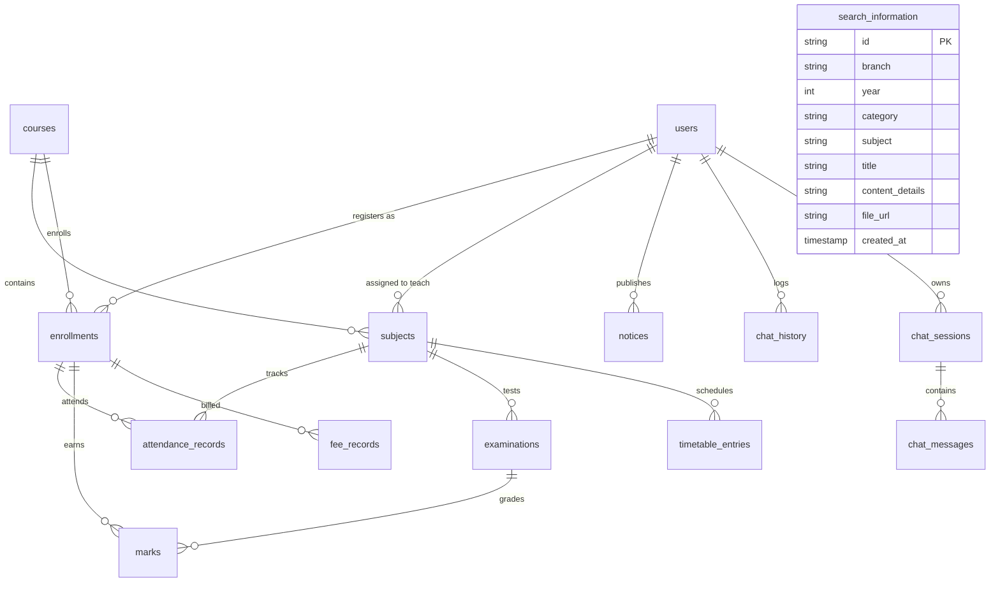

# Database Design Specification

## 1. Schema Overview & Relational Architecture

The CSIC database utilizes an ANSI SQL standard relational design, normalized to Third Normal Form (3NF) to maintain referential integrity without unnecessary enterprise bloat.

### Dual Database Engine Support
- **Local Development & Testing**: SQLite 3 (`database/csic.db`). Zero external daemon configuration; instant startup; file-backed persistence.
- **Production Deployment**: Cloud PostgreSQL 16+ via `DATABASE_URL` (Supabase / Render) with connection pooling.
- **Query Abstraction**: All queries execute through `backend/app/repositories/sql_repository.py` using pure parameterized SQL (`?` placeholders automatically mapped to `%s` on PostgreSQL). No ORM is used.

### Active Migration Chain
The active database is initialized through sequential migrations in `database/migrations/`:
1. **`001_simple_schema.sql`**: Core academic tables (`users`, `courses`, `subjects`, `enrollments`, `attendance_records`, `examinations`, `marks`, `fee_records`, `timetable_entries`, `notices`, `chat_history`).
2. **`002_seed_data.sql`**: Seed data for demo students (Rashi, Vanshika, Silki, Akshit), course subjects, attendance logs, marks, fees, and timetables.
3. **`003_chat_sessions.sql`**: Conversational session management (`chat_sessions`, `chat_messages`).
4. **`004_update_demo_students.sql`**: Student profile normalization.
5. **`005_sync_demo_accounts.sql`**: Bcrypt password hash synchronization (`1234`) across demo accounts.
6. **`006_search_information.sql`**: Search Information module repository (`search_information`).

### Schema Evolution & Historical Context
The CSIC database design has evolved across three distinct architectural phases:
1. **Academic Synopsis Baseline (4 Modules):** The original project synopsis mapped four modules: Student Module, Admin Module, Chatbot Engine Module, and Search Information Module. The conceptual schema with sample institutional data is preserved in `database/modules_schema.sql` for viva defense.
2. **Enterprise Schema Iteration (21 Tables - Archived):** An intermediate enterprise version introduced excessive abstraction (21 tables, stored views, SQL triggers, and row-level security policies). To optimize performance, eliminate query latency, and make the code accessible for academic presentation, this version was archived in `database/migrations/archive_21_table/`.
3. **Current Active Architecture (14 Normalized Core Tables):** A clean, Third Normal Form (3NF) relational design using standard parameterized SQL without ORM bloat. It provides 100% dialect portability between local development (SQLite 3) and cloud production (PostgreSQL 16).

---

## 2. Active Entity-Relationship Model (14 Core Tables)



---

## 3. Table Specifications & Constraints

### 3.1 Authentication & User Management
- **`users`**: System users (Students, Faculty, Administrators).
  - `id VARCHAR(64) PRIMARY KEY`: Unique identifier (`stu-001`, `fac-001`, `admin-001`).
  - `name VARCHAR(100) NOT NULL`: Display name.
  - `email VARCHAR(150) NOT NULL UNIQUE`: Login email.
  - `password_hash VARCHAR(255) NOT NULL`: Secure bcrypt hash.
  - `role VARCHAR(20) NOT NULL CHECK (role IN ('student', 'faculty', 'admin'))`.
  - `phone VARCHAR(30)`.
  - `avatar_url VARCHAR(255)`.
  - `is_active BOOLEAN NOT NULL DEFAULT 1` (`TRUE`).
  - `created_at TIMESTAMP DEFAULT CURRENT_TIMESTAMP`.

### 3.2 Academic Curriculum & Enrollments
- **`courses`**: Academic degree programs.
  - `id VARCHAR(64) PRIMARY KEY` (`crs-01`).
  - `code VARCHAR(20) NOT NULL UNIQUE` (`BTECH-CSE`).
  - `name VARCHAR(150) NOT NULL`.
  - `department VARCHAR(100) NOT NULL`.

- **`subjects`**: Course curriculum subjects.
  - `id VARCHAR(64) PRIMARY KEY` (`sub-01` to `sub-04`).
  - `course_id VARCHAR(64) NOT NULL REFERENCES courses(id) ON DELETE CASCADE`.
  - `code VARCHAR(20) NOT NULL UNIQUE` (`CS401`, `CS402`, `CS403`, `CS404`).
  - `name VARCHAR(150) NOT NULL`.
  - `credits NUMERIC(3,1) NOT NULL DEFAULT 4.0`.
  - `semester INT NOT NULL CHECK (semester BETWEEN 1 AND 8)`.
  - `faculty_id VARCHAR(64) REFERENCES users(id) ON DELETE SET NULL`.

- **`enrollments`**: Students registered in courses.
  - `id VARCHAR(64) PRIMARY KEY` (`enr-001` to `enr-004`).
  - `user_id VARCHAR(64) NOT NULL REFERENCES users(id) ON DELETE CASCADE`.
  - `course_id VARCHAR(64) NOT NULL REFERENCES courses(id) ON DELETE RESTRICT`.
  - `roll_number VARCHAR(30) NOT NULL UNIQUE` (`CS2023001` - Rashi, etc.).
  - `semester INT NOT NULL DEFAULT 6`.
  - `section VARCHAR(10) NOT NULL DEFAULT 'A'`.
  - `status VARCHAR(20) NOT NULL DEFAULT 'active' CHECK (status IN ('active', 'completed', 'dropped'))`.
  - `UNIQUE(user_id, course_id)`.

### 3.3 Academic Operations & Performance
- **`attendance_records`**: Session-wise attendance logs.
  - `id VARCHAR(64) PRIMARY KEY`.
  - `enrollment_id VARCHAR(64) NOT NULL REFERENCES enrollments(id) ON DELETE CASCADE`.
  - `subject_id VARCHAR(64) NOT NULL REFERENCES subjects(id) ON DELETE CASCADE`.
  - `session_date DATE NOT NULL`.
  - `status VARCHAR(20) NOT NULL CHECK (status IN ('present', 'absent', 'excused'))`.
  - `remarks VARCHAR(255)`.
  - `UNIQUE(enrollment_id, subject_id, session_date)`.

- **`examinations`**: Academic assessments.
  - `id VARCHAR(64) PRIMARY KEY` (`exam-01` to `exam-04`).
  - `subject_id VARCHAR(64) NOT NULL REFERENCES subjects(id) ON DELETE CASCADE`.
  - `name VARCHAR(100) NOT NULL` (`Mid-Term`, `End-Term`).
  - `exam_date DATE NOT NULL`.
  - `max_marks NUMERIC(5,2) NOT NULL CHECK (max_marks > 0)`.
  - `weightage_percentage NUMERIC(5,2) DEFAULT 30.0`.

- **`marks`**: Examination scores awarded to students.
  - `id VARCHAR(64) PRIMARY KEY`.
  - `examination_id VARCHAR(64) NOT NULL REFERENCES examinations(id) ON DELETE CASCADE`.
  - `enrollment_id VARCHAR(64) NOT NULL REFERENCES enrollments(id) ON DELETE CASCADE`.
  - `marks_obtained NUMERIC(5,2) NOT NULL CHECK (marks_obtained >= 0)`.
  - `is_absent BOOLEAN NOT NULL DEFAULT FALSE`.
  - `grade VARCHAR(5)`.
  - `UNIQUE(examination_id, enrollment_id)`.

- **`fee_records`**: Financial ledger for student fee obligations.
  - `id VARCHAR(64) PRIMARY KEY`.
  - `invoice_number VARCHAR(50) NOT NULL UNIQUE`.
  - `enrollment_id VARCHAR(64) NOT NULL REFERENCES enrollments(id) ON DELETE CASCADE`.
  - `title VARCHAR(150) NOT NULL`.
  - `amount NUMERIC(10,2) NOT NULL CHECK (amount > 0)`.
  - `amount_paid NUMERIC(10,2) NOT NULL DEFAULT 0.00`.
  - `due_date DATE NOT NULL`.
  - `status VARCHAR(20) NOT NULL DEFAULT 'unpaid' CHECK (status IN ('unpaid', 'partially_paid', 'paid'))`.

- **`timetable_entries`**: Weekly recurring lecture and lab slots.
  - `id VARCHAR(64) PRIMARY KEY`.
  - `subject_id VARCHAR(64) NOT NULL REFERENCES subjects(id) ON DELETE CASCADE`.
  - `day_of_week VARCHAR(15) NOT NULL CHECK (day_of_week IN ('Monday', 'Tuesday', 'Wednesday', 'Thursday', 'Friday', 'Saturday'))`.
  - `start_time VARCHAR(10) NOT NULL`.
  - `end_time VARCHAR(10) NOT NULL`.
  - `room_number VARCHAR(50) NOT NULL`.

- **`notices`**: Campus bulletins and circulars.
  - `id VARCHAR(64) PRIMARY KEY`.
  - `title VARCHAR(200) NOT NULL`.
  - `content TEXT NOT NULL`.
  - `category VARCHAR(50) NOT NULL CHECK (category IN ('academic', 'examination', 'fees', 'event', 'urgent', 'administrative'))`.
  - `target_role VARCHAR(20) NOT NULL DEFAULT 'all' CHECK (target_role IN ('all', 'student', 'faculty'))`.
  - `published_by VARCHAR(64) REFERENCES users(id) ON DELETE SET NULL`.
  - `is_published BOOLEAN NOT NULL DEFAULT TRUE`.
  - `published_at TIMESTAMP DEFAULT CURRENT_TIMESTAMP`.

### 3.4 Conversational Engine & Search Modules
- **`chat_history`**: Direct conversational turn logs.
  - `id VARCHAR(64) PRIMARY KEY`.
  - `user_id VARCHAR(64) NOT NULL REFERENCES users(id) ON DELETE CASCADE`.
  - `message TEXT NOT NULL`.
  - `reply TEXT NOT NULL`.
  - `intent VARCHAR(50) NOT NULL`.
  - `created_at TIMESTAMP DEFAULT CURRENT_TIMESTAMP`.

- **`chat_sessions`**: Multi-turn conversation threads.
  - `id VARCHAR(64) PRIMARY KEY`.
  - `user_id VARCHAR(64) NOT NULL REFERENCES users(id) ON DELETE CASCADE`.
  - `title VARCHAR(200) NOT NULL`.
  - `created_at TIMESTAMP DEFAULT CURRENT_TIMESTAMP`.
  - `updated_at TIMESTAMP DEFAULT CURRENT_TIMESTAMP`.

- **`chat_messages`**: Detailed session message turns with source metadata.
  - `id VARCHAR(64) PRIMARY KEY`.
  - `session_id VARCHAR(64) NOT NULL REFERENCES chat_sessions(id) ON DELETE CASCADE`.
  - `sender_role VARCHAR(20) NOT NULL CHECK (sender_role IN ('user', 'assistant', 'system'))`.
  - `message_text TEXT NOT NULL`.
  - `query_type VARCHAR(50)`.
  - `sources TEXT`.
  - `verified_data TEXT`.
  - `created_at TIMESTAMP DEFAULT CURRENT_TIMESTAMP`.

- **`search_information`** (Module 4: Search Information Module):
  - Stores institutional academic information filterable by branch, year, category, and subject.
  - `id VARCHAR(64) PRIMARY KEY`.
  - `branch VARCHAR(100) NOT NULL`.
  - `year INT NOT NULL CHECK (year BETWEEN 1 AND 4)`.
  - `category VARCHAR(50) NOT NULL` (Syllabus, Timetable, Results, Fees, FAQ).
  - `subject VARCHAR(150) NOT NULL`.
  - `title VARCHAR(200) NOT NULL`.
  - `content_details TEXT NOT NULL`.
  - `file_url VARCHAR(255)`.
  - `created_at TIMESTAMP DEFAULT CURRENT_TIMESTAMP`.
  - Indexes: `idx_search_info_lookup(branch, year, category)`, `idx_search_info_subject(subject)`.

---

## 4. Basic SQL Operations in CSIC

All database interactions adhere to standard, college-level basic SQL operations without ORM abstraction.

### 4.1 SELECT with WHERE (Simple Lookup)
Retrieve active user credentials by email:
```sql
SELECT id, name, email, role, password_hash
FROM users
WHERE LOWER(email) = LOWER(?)
  AND is_active = 1;
```

### 4.2 Relational JOIN (Student Profile Resolution)
Fetch student details along with their course and roll number:
```sql
SELECT
    u.id AS user_id,
    u.name AS student_name,
    u.email,
    e.roll_number,
    c.name AS course_name,
    e.semester,
    e.section
FROM users u
JOIN enrollments e ON e.user_id = u.id
JOIN courses c ON c.id = e.course_id
WHERE u.id = ?;
```

### 4.3 GROUP BY and SQL Aggregations (Attendance Summary)
Compute overall attendance and total attended sessions per subject:
```sql
SELECT
    s.id AS subject_id,
    s.code AS subject_code,
    s.name AS subject_name,
    COUNT(a.id) AS total_sessions,
    SUM(CASE WHEN a.status = 'present' THEN 1 ELSE 0 END) AS attended_sessions,
    ROUND((SUM(CASE WHEN a.status = 'present' THEN 1.0 ELSE 0.0 END) / COUNT(a.id)) * 100.0, 2) AS percentage
FROM attendance_records a
JOIN subjects s ON s.id = a.subject_id
JOIN enrollments e ON e.id = a.enrollment_id
WHERE e.user_id = ?
GROUP BY s.id, s.code, s.name;
```

### 4.4 Parameterized INSERT (Publish Notice)
Create a new campus announcement:
```sql
INSERT INTO notices (id, title, category, content, target_role, published_by, is_published, published_at)
VALUES (?, ?, ?, ?, ?, ?, 1, CURRENT_TIMESTAMP);
```

### 4.5 Parameterized UPDATE (Fee Payment)
Update invoice paid amount and payment status:
```sql
UPDATE fee_records
SET amount_paid = amount_paid + ?,
    status = CASE WHEN amount_paid + ? >= amount THEN 'paid' ELSE 'partially_paid' END
WHERE id = ?;
```

### 4.6 Parameterized DELETE (Session Cleanup)
Delete a chat session and cascade its associated messages:
```sql
DELETE FROM chat_sessions
WHERE id = ? AND user_id = ?;
```

### 4.7 Multi-Filter Search Query (Search Information Module)
Filter academic documents by year, category, and keyword:
```sql
SELECT id, branch, year, category, subject, title, content_details, file_url
FROM search_information
WHERE year = ?
  AND LOWER(category) = LOWER(?)
  AND (LOWER(title) LIKE ? OR LOWER(content_details) LIKE ?)
ORDER BY year ASC, id ASC;
```

---

## 5. Summary of Schema Guarantees

1. **Academic Alignment**: The 14 tables directly fulfill the 4 modules specified in the academic synopsis.
2. **Relational Integrity**: Enforced through foreign keys with `ON DELETE CASCADE` where appropriate, `NOT NULL` constraints, and domain `CHECK` constraints (e.g., year 1–4, attendance percentage >= 0).
3. **No Hidden Layers**: No stored procedures, triggers, or ORM migrations are required. Pure SQL scripts initialize and run the database cleanly.
