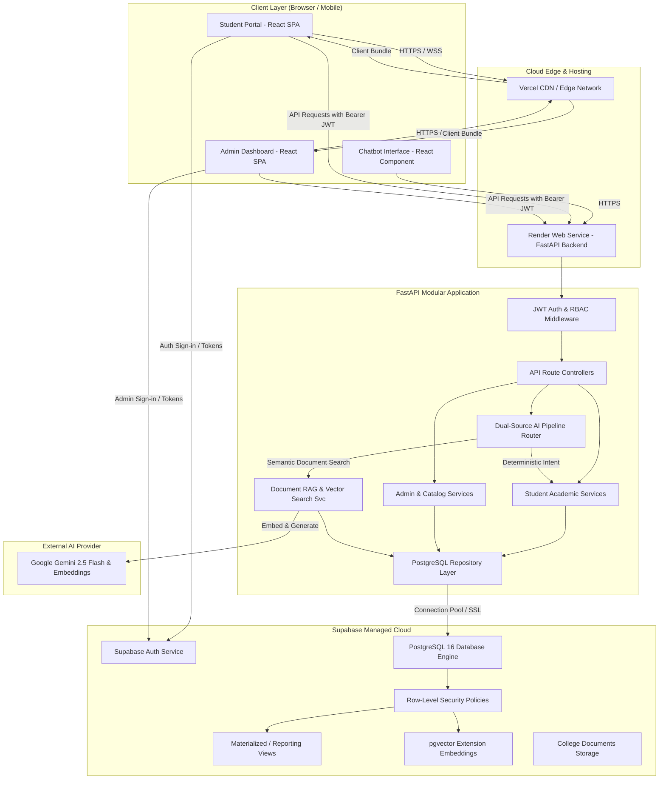
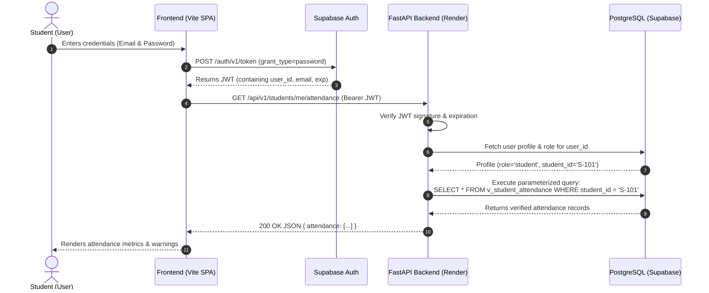

# System Design Specification

## 1. System Overview
The **Cloud-Based Student Information Chatbot (CSIC)** is a cloud-native academic information and conversational system designed for college environments. It provides role-governed portals for students and administrators, paired with a reliable, source-grounded AI chatbot capable of answering student-specific academic questions and institutional policy queries.

---

## 2. Component Breakdown

### 2.1 Frontend (React + TypeScript + Vite + Tailwind CSS)
- **Role:** Delivers a responsive Single Page Application (SPA) deployed to Vercel.
- **Key Modules:**
  - `StudentDashboard`: Visualizes personal attendance percentages, subject-wise marks, upcoming timetables, outstanding fees, and notices.
  - `AdminDashboard`: Allows authorized faculty and administrators to manage student records, post notices, configure timetables, and upload policy documents.
  - `ChatbotDrawer`: A conversational floating assistant offering quick prompt suggestions, message history, clear citations for policy facts, and real-time loading feedback.
  - `AuthGuard`: Client-side route protection checking session validity and role permissions.

### 2.2 Backend (FastAPI + Pydantic v2 + Python 3.12)
- **Role:** Provides high-performance, asynchronous REST APIs running on Render.
- **Architectural Layers:**
  - **Routers (`api/v1/`):** Request validation, parameter serialization, status codes.
  - **Dependencies / Auth:** JWT signature and claims validation, role checking, database connection acquisition.
  - **Services (`services/`):** Business logic, calculation of attendance denominators, invoice status checks, LLM prompt orchestration.
  - **Repositories (`repositories/`):** Parameterized SQL queries and views invocation; sets local PostgreSQL session variables for RLS enforcement.

### 2.3 Database (Supabase Managed PostgreSQL 16)
- **Role:** Central source of truth for structured academic data, authentication identities, role definitions, audit logs, and vector embeddings.
- **Key Capabilities:**
  - Row-Level Security (RLS) guaranteeing multi-tenant student privacy at the database level.
  - Standardized timestamps (`TIMESTAMPTZ`) and explicit numeric precision (`NUMERIC(5,2)` for percentages and marks, `NUMERIC(10,2)` for fees).
  - Pre-computed reporting views for faculty workload, student attendance warnings, and semester summaries.
  - Vector similarity search using `pgvector` for document chunks.

### 2.4 AI Engine (Dual-Source Query Routing)
- **Architecture:**
  - **Deterministic Pipeline:** Strict intent extraction matching user questions to specific authorized database queries (e.g., "my marks" -> `get_student_marks(current_student_id)`). **Zero dynamic SQL generation by the LLM.**
  - **Semantic RAG Pipeline:** For questions about college regulations, exam guidelines, or holiday policies, retrieves top-k relevant document chunks from `documents` and `document_chunks` and synthesizes answers using Gemini 2.5 Flash with mandatory source citations.

---

## 3. Authentication & Authorization Flow

---

## 4. Security Boundaries and Mitigations

| Threat Vector | Mitigation Strategy |
| :--- | :--- |
| **Cross-Student Data Leakage** | Backend forces `student_id = token.user_id`; database enforces RLS policies checking `student_id = auth.uid()`. |
| **Privilege Escalation** | `profiles.role` column is immutable by non-admin roles; RLS disallows updates to `role` column by ordinary users. |
| **Prompt Injection in Chatbot** | System prompt enforces strict boundary between system instructions and retrieved context. Context chunks are formatted as passive reference data. |
| **SQL Injection** | Exclusively parameterized SQL queries (`asyncpg` parameter binding `$1, $2`); no dynamic string concatenation. |
| **Leaked Secrets** | Server-side environment variables for API keys and database credentials; client bundle contains only public anon keys. |
| **DDoS / Chatbot Abuse** | Endpoint-level rate limiting on `/api/v1/chat` and payload size limits. |

---

## 5. Observability and Health Probes
- `/health/live`: Returns `200 OK` indicating the FastAPI process is alive.
- `/health/ready`: Performs an active `SELECT 1` ping to the PostgreSQL database and checks AI provider configuration status, returning `200 OK` or `503 Service Unavailable` without leaking connection strings.
- Structured JSON logging across all backend requests with sanitized correlation IDs.
