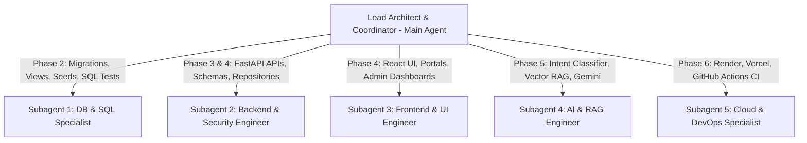

# Master Implementation Plan

## 1. Executive Summary
This document outlines the step-by-step phased execution plan for constructing the **Cloud-Based Student Information Chatbot (CSIC)**. The architecture adheres to rigorous production standards, combining advanced PostgreSQL engineering, FastAPI backend micro-modular design, responsive React + TypeScript frontend, Supabase Row-Level Security, and a dual-source AI chatbot.

---

## 2. Subagent Orchestration & Parallel Allocation Strategy
To maximize execution velocity, modularity, and clean boundaries without merge conflicts, specialized subagents will be assigned distinct roles:

### Subagent Responsibilities:
1. **`db-specialist` (PostgreSQL & SQL Engineering):**
   - Owns `database/migrations/` and `docs/sql/`.
   - Creates the 21 normalized tables, composite indexes, 10 reporting views, and synthetic seed datasets.
   - Implements SQL demonstration scripts and automated PostgreSQL schema validation tests.
2. **`backend-engineer` (FastAPI, Auth & API Architecture):**
   - Owns `backend/app/` (core, models, api, services, repositories).
   - Implements JWT verification, RBAC middleware, Pydantic schemas, and REST endpoints.
   - Implements unit and integration test suite using `pytest`.
3. **`frontend-engineer` (React, TypeScript & Dashboard UI):**
   - Owns `frontend/src/` (components, pages, services, hooks, styles).
   - Implements student dashboard, admin portal, accessible tables, charts, and state handling.
   - Configures Vite, Tailwind CSS, Lucide icons, and tests with Vitest/React Testing Library.
4. **`ai-engineer` (Chatbot & RAG Integration):**
   - Owns `backend/app/services/ai/` and `frontend/src/components/chat/`.
   - Implements the dual-source intent router: maps student queries deterministically to SQL views, routes policy questions to vector search.
   - Integrates `google-genai` SDK with fallback mock mode for environments without API keys.
5. **`cloud-devops-engineer` (Cloud Deployment & CI/CD):**
   - Owns `render.yaml`, `vercel.json`, and `.github/workflows/ci.yml`.
   - Writes cloud deployment verification scripts, health probe verification, and deployment guides.

---

## 3. Phased Execution Workflow

### Phase 1: Foundation & Baseline Setup
- Initialize Git repository and standard `.gitignore`.
- Set up directory skeleton (`backend/`, `frontend/`, `database/`, `docs/`).
- Create backend `requirements.txt` with pinned dependencies (`fastapi`, `uvicorn`, `pydantic`, `psycopg`, `pytest`, `python-jose`, `google-genai`).
- Create frontend Vite React TypeScript package with Tailwind CSS.
- Establish `/health/live` and `/health/ready` endpoints.

### Phase 2: PostgreSQL Engineering & Schema Migrations
- Migration 001: 21 relational tables with strict keys, constraints, and audit logging.
- Migration 002: 10 academic and operational reporting views.
- Migration 003: Deterministic synthetic seed data covering multiple departments, students, enrollments, attendance records, marks, invoices, and timetables.
- Write SQL learning demonstration scripts (`docs/sql/demonstrations.md`) explaining multi-table joins, CTEs, window functions, and `EXPLAIN` query plans.
- Implement database tests verifying foreign key constraints, unique constraints, and view accuracy.

### Phase 3: Row-Level Security & Authentication Layer
- Migration 004: Comprehensive RLS policies enforcing the 3 roles (`student`, `faculty`, `admin`).
- Implement JWT token parser and validator in FastAPI dependency injection.
- Implement automated negative security tests: verify Student A cannot access Student B's data; verify non-admin cannot update role.

### Phase 4: Full-Stack Portals (Student & Admin)
- Backend API endpoints: Students, Attendance, Marks, Fees, Timetable, Notices, Admin CRUD.
- Frontend views:
  - Student Dashboard: Attendance breakdown card, Low Attendance warning badge, Marks table, Timetable schedule, Fee invoice list.
  - Admin Dashboard: Student roster management, Course assignment, Notice publisher, Attendance batch entry.
- Implement responsive design, loading skeletons, error toasts, and empty states.

### Phase 5: AI Chatbot & Document RAG
- Dual-source query router implementation.
- Structured queries: Extract student intent (`attendance`, `marks`, `fees`, `timetable`) and call verified backend repositories directly.
- Document RAG: Parse college handbook and circulars, generate embeddings, perform vector similarity search, and format answer with source citations.
- Conversational chat interface drawer with quick suggestion pills.

### Phase 6: Cloud Deployment & CI/CD
- Generate `render.yaml` for Render FastAPI web service deployment.
- Generate `vercel.json` with SPA catch-all rewrites for Vercel deployment.
- Configure `.github/workflows/ci.yml` running frontend build, type checks, backend pytest, and linting.
- Document cloud cost breakdown and operational runbooks.

### Phase 7: Verification & Final Academic Deliverables
- Execute complete test suites and generate verifiable logs.
- Prepare presentation deck, viva questions (`docs/presentation/viva-prep.md`), and demonstration walkthrough.
- Compile final comprehensive project report.
