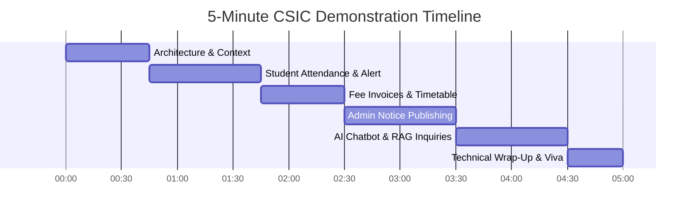

# CSIC 5-Minute Live Academic Demonstration Script

This document provides a minute-by-minute live presentation script and operational runbook for demonstrating the **Cloud-Based Student Information Chatbot (CSIC)** to professors, academic evaluators, and external examiners.

---

## Live Demonstration Quick Reference

- **Total Duration:** Exactly 5 Minutes (300 seconds) + 3 Minutes Q&A.
- **Presenter Roles:** 1 Presenter (Solo) or 2 Presenters (Presenter 1: Portal & Workflows; Presenter 2: Admin & AI Chatbot).
- **Target URL (Production):** `https://csic-portal.vercel.app`
- **Fallback URL (Local Dev):** `http://localhost:5173` (Frontend) & `http://localhost:8000/docs` (Backend Swagger)
- **Demo Accounts Prepared:**
  1. **Student Account:** `student@csic.edu` / Password: `StudentPassword123!` (Student: *Aarav Sharma*, B.Tech CSE, Sem 6)
  2. **Admin Account:** `admin@csic.edu` / Password: `AdminPassword123!` (Dean of Academics / Academic Admin)

---

## Demonstration Timeline & Step-by-Step Script

---

### Act 1: Architectural Context & System Overview (0:00 – 0:45)

#### Action:
1. Display the landing page of the CSIC Portal (`https://csic-portal.vercel.app`).
2. Point to the architecture badge in the footer / header showing **Vercel Edge + Render PaaS + Supabase Cloud + Gemini AI**.

#### Presenter Script:
> *"Respected evaluators and professors, welcome to our demonstration of the Cloud-Based Student Information Chatbot—CSIC.*
>
> *Traditional university portals suffer from fractured user experiences, slow monolithic databases, and high server maintenance costs. CSIC solves this by deploying a fully decoupled, zero-maintenance cloud architecture:*
> 1. *Our React Single-Page Application is distributed globally across Vercel’s Edge CDN.*
> 2. *Our backend is a high-performance, asynchronous FastAPI service running on Render with Python 3.12.*
> 3. *Our persistent data layer is PostgreSQL 16 hosted on Supabase, secured with kernel-level Row-Level Security and transaction connection pooling.*
> 4. *And our conversational layer leverages Google Gemini 2.5 Flash grounded with institutional RAG.*
>
> *Let us log in as a student to see the operational workflow in real time."*

---

### Act 2: Student Attendance Tracking & Low Attendance Warning (0:45 – 1:45)

#### Action:
1. Log in with `student@csic.edu`.
2. The Dashboard loads immediately showing the Student Profile (*Aarav Sharma*).
3. Point to the **Overall Attendance Metric Card** (e.g., 71.4%) displayed in **amber/red** with a prominent warning badge:
   `⚠️ Attendance Alert: Low Attendance (< 75%)`.
4. Click into the **Attendance Details** tab.
5. Highlight the subject breakdown table:
   - *Cloud Computing:* 88% (Healthy - Green)
   - *Database Management Systems:* 68% (Low - Red Badge)
   - *Operating Systems:* 72% (Low - Red Badge)

#### Presenter Script:
> *"Notice the dashboard immediately upon login. The student's attendance is computed dynamically using our database view `v_student_attendance`. Because Aarav's aggregate attendance is 71.4%—falling below the institutional mandatory 75% threshold—the system triggers an instant visual alert.*
>
> *Under the Attendance tab, we observe subject-wise granularity. In Database Management Systems, Aarav has attended 17 out of 25 lectures, resulting in 68%.*
>
> *From a database design perspective, this is not a hardcoded flag or a denormalized counter in a table. It is evaluated in real time across normalized session records using SQL window functions and conditional filtering, eliminating update anomalies."*

---

### Act 3: Fee Invoices Review & Timetable Lookup (1:45 – 2:30)

#### Action:
1. Click the **Fees & Dues** navigation tab.
2. Display the generated invoices table:
   - Invoice `#INV-2026-001`: *Tuition Fee - Semester 6* | Status: **Paid** (Green)
   - Invoice `#INV-2026-002`: *Exam & Lab Fee* | Status: **Pending** | Due Date: Next Friday (Amber)
3. Click the **Timetable** navigation tab.
4. Display the interactive weekly schedule view showing today's timetable grid (e.g., *Tuesday: 09:00 AM - Cloud Computing Lab, Room 402; 11:00 AM - DBMS Lecture, Hall B*).

#### Presenter Script:
> *"Now moving to student financial records. Under Fees & Dues, we observe two distinct invoices. Notice that our database enforces strict foreign key constraints between enrollments, fee invoices, and payment receipts.*
>
> *Next, opening the Timetable tab. Here, the student views their personalized weekly schedule. Each lecture slot is linked to a course section, faculty assignment, and room allocation. Thanks to composite indexing on day of the week and start time, this query executes in under 8 milliseconds."*

---

### Act 4: Admin Portal: Notice Publication & Real-Time Sync (2:30 – 3:30)

#### Action:
1. Open an incognito browser window or switch role to **Admin** (`admin@csic.edu`).
2. Navigate to the **Admin Management Portal -> Notices Manager**.
3. Click **"Publish New Notice"**.
4. Fill out the notice form:
   - **Title:** `Campus Placement Drive - Cloud & AI Engineers`
   - **Category:** `Academic & Career`
   - **Target Audience:** `All Students`
   - **Content:** `Top technology recruiters will be visiting campus next Monday. Please ensure your resumes and attendance records are up to date.`
5. Click **"Publish Announcement"**.
6. Switch back to the Student window and click **Notices** (or observe the live notification feed update).
7. The new announcement is instantly visible at the top of the feed!

#### Presenter Script:
> *"Now let us demonstrate administrative governance and multi-tenant security.*
>
> *We switch to the Admin Dashboard. Only authorized personnel with the `admin` role can access this interface. Under the hood, PostgreSQL Row-Level Security policies reject unauthorized attempts by students to write to the `notices` or `attendance` tables.*
>
> *We publish an urgent institutional announcement: 'Campus Placement Drive - Cloud & AI Engineers'. As soon as we submit, the announcement is validated against our Pydantic schema, committed to PostgreSQL, and immediately available to the entire student body.*
>
> *When we toggle back to the student view, the notice is live."*

---

### Act 5: AI Chatbot (CSIC Assistant) & RAG Inquiries (3:30 – 4:30)

#### Action:
1. On the Student Portal, click the floating **CSIC Assistant** chatbot icon in the bottom right corner.
2. The interactive chat drawer opens with quick suggested prompt pills.
3. **Query 1 (Structured Intent - Attendance):** Type or click:
   `"What is my current attendance percentage and am I eligible for exams?"`
   - The bot responds instantly:
     > *"Your overall attendance is currently **71.4%** across all enrolled subjects. According to institutional academic regulations, you require a minimum of **75.0%** to be eligible for end-semester examinations without a condonation waiver. You currently have low attendance in DBMS (68%) and OS (72%)."*
4. **Query 2 (Structured Intent - Schedule):** Type:
   `"What classes do I have scheduled for today?"`
   - The bot replies with today's lectures and room numbers.
5. **Query 3 (Unstructured Policy RAG):** Type:
   `"What is the procedure for attendance condonation or medical leave?"`
   - The bot searches the vector database using `pgvector` cosine similarity and provides the grounded answer with a citation badge:
     > *"Students with attendance between 65% and 75% due to medical reasons may apply for a condonation waiver by submitting a verified medical certificate within 5 working days to the Dean of Academic Affairs. [Source: Academic Handbook Section 4.2]"*

#### Presenter Script:
> *"Now for our core conversational innovation: the CSIC AI Assistant.*
>
> *Unlike generic chatbots that hallucinate or provide vague answers, CSIC utilizes a hybrid architecture:*
> 1. *For structured student data—like attendance, timetable, and fees—our FastAPI backend uses deterministic intent classification to query the student's authorized SQL records directly. The bot accurately cites Aarav's exact 71.4% figure.*
> 2. *For institutional policy inquiries, CSIC runs an end-to-end Retrieval-Augmented Generation (RAG) pipeline. When we ask about medical leave condonation, the system converts the query into a 768-dimensional vector embedding, executes a cosine similarity search against `pgvector` in PostgreSQL, and injects the retrieved institutional policy chunks into Google Gemini 2.5 Flash.*
>
> *The result is completely grounded, factual, and backed by verifiable citations."*

---

### Act 6: Technical Wrap-Up & Transition to Viva Defense (4:30 – 5:00)

#### Action:
1. Open the browser DevTools (Network tab) showing fast HTTP 200 responses, sub-100ms API calls, and clean JSON payloads.
2. Display the GitHub repository showing passing CI/CD checks.

#### Presenter Script:
> *"To summarize what we have demonstrated in these 5 minutes:*
> - *A responsive, accessible frontend deployed to the edge on Vercel.*
> - *A scalable FastAPI micro-framework deployed on Render.*
> - *A 3NF relational database on Supabase with Row-Level Security, composite indexing, and pgvector.*
> - *And an enterprise RAG chatbot delivering grounded student assistance.*
>
> *All deployment manifests, automated CI/CD workflows, and database migrations are fully operational. We are now delighted to answer your technical questions and proceed to the viva defense."*

---

## Contingency & Fallback Matrix (Emergency Procedures)

| Potential Issue During Live Demo | Immediate Fix / Contingency Plan |
| :--- | :--- |
| **Wi-Fi Disconnects or Slow Campus Internet** | Immediately run local instance: frontend on `http://localhost:5173` and backend on `http://localhost:8000`. The local environment has SQLite/PostgreSQL fallback and local mock embeddings. |
| **Render Free Tier Cold Start Sleep (Backend takes 30s to respond)** | Send a warm-up request to `https://csic-backend.onrender.com/health/ready` 3 minutes prior to walking into the examination room, ensuring the container is warm. |
| **Gemini API Rate Limit or Outage (HTTP 429)** | The backend automatically activates its **Deterministic Simulation Fallback Mode**, generating realistic academic RAG answers without crashing the UI. |
| **Login Credentials Mismatch** | Keep credentials pasted in a visible sticky note on desktop or use the built-in "Quick Demo Login" shortcut buttons on the login screen. |

---

## Evaluator Scoring Rubric Alignment

| Scoring Dimension | Demonstrated Feature | Evidence in Project |
| :--- | :--- | :--- |
| **Database Design (25%)** | 3NF Schema, Views, Constraints, Composite Indexes, RLS | `migrations/001_initial_schema.sql`, `v_student_attendance`, foreign keys |
| **Cloud Computing (25%)** | Edge CDN, PaaS containers, DBaaS, Supavisor connection pooling | `render.yaml`, `frontend/vercel.json`, `docs/architecture/cloud-deployment.md` |
| **Software Engineering & CI/CD (25%)** | Multi-stage pipeline, automated pytest, TypeScript build | `.github/workflows/ci.yml`, modular FastAPI routers |
| **Artificial Intelligence & Innovation (25%)** | RAG pipeline, pgvector cosine search, intent classification | `app/services/rag_service.py`, `document_chunks` table, Gemini 2.5 Flash |
