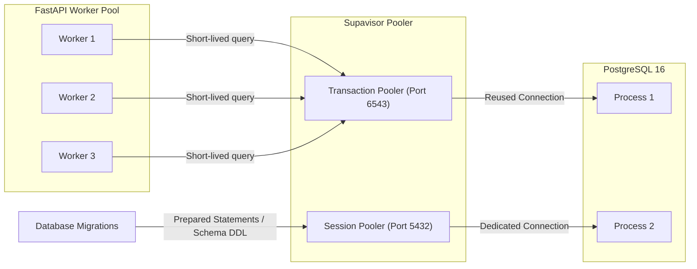
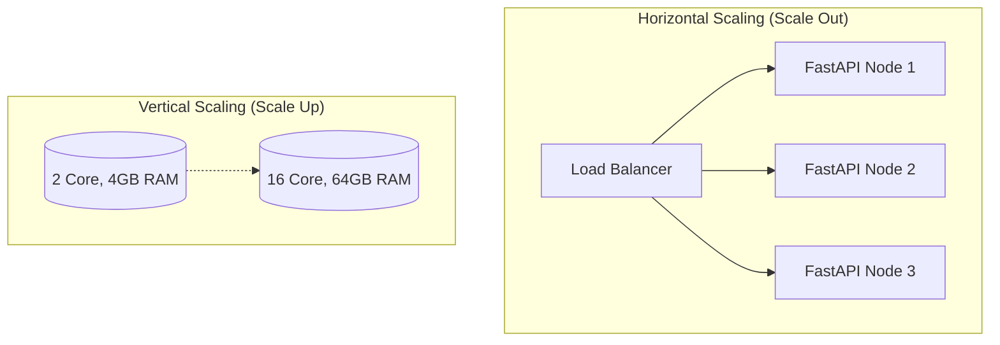
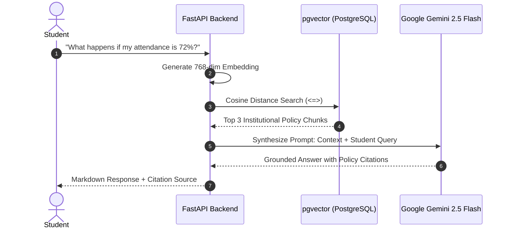

# CSIC Academic Viva Voce & Technical Defense Guide

This comprehensive viva voce preparation guide provides academically rigorous, industry-grade questions and model answers designed for final-year evaluations, external viva examiners, technical panel reviews, and systems defense.

---

## Table of Contents
1. [Viva Overview & Examiner Assessment Dimensions](#1-viva-overview--examiner-assessment-dimensions)
2. [Category A: Advanced SQL & Database Engineering (Q1 – Q11)](#2-category-a-advanced-sql--database-engineering)
3. [Category B: Cloud Computing, DevOps & Systems Architecture (Q12 – Q23)](#3-category-b-cloud-computing-devops--systems-architecture)
4. [Examiner Quick-Check Matrix & Academic Formulae](#4-examiner-quick-check-matrix--academic-formulae)

---

## 1. Viva Overview & Examiner Assessment Dimensions

Academic evaluators evaluate student project submissions across four core technical competencies:
- **Relational Integrity & Theoretical Soundness:** Understanding normalization, relational algebra, ACID guarantees, transaction isolation, and index algorithms.
- **Query Performance & Optimization:** Demonstrating why specific queries perform well, how the PostgreSQL query planner executes plans, and how to avoid $O(N)$ full table scans.
- **Distributed Cloud Infrastructure:** Understanding decoupled architectures, stateless computing, connection pooling, zero-secret security models, and cold starts.
- **Applied AI & Information Retrieval:** Grounding generative AI responses, vector embeddings, cosine similarity metrics, and preventing hallucination via deterministic fallbacks.

---

## 2. Category A: SQL & Relational Database Engineering

> [!NOTE]
> **Core Architecture Note:** All 10 live reporting views and application queries in CSIC rely strictly on **Basic-to-Intermediate Relational SQL** (Joins, Aggregations, GROUP BY/HAVING, CASE expressions, and Views) to guarantee maximum clarity, maintainability, and educational value. Advanced constructs (Window Functions, CTE pipelines) are covered below as academic extension topics.

### Q1: What is Third Normal Form (3NF), how does CSIC adhere to it, and when is denormalization justified?
**Examiner Focus:** Theoretical relational database normalization vs real-world performance trade-offs.

**Model Answer:**
A relational schema is in **Third Normal Form (3NF)** if and only if:
1. It is in **First Normal Form (1NF)**: Every column holds atomic (indivisible) values and each row is unique.
2. It is in **Second Normal Form (2NF)**: It is in 1NF and contains **no partial dependencies** (every non-key attribute is fully functionally dependent on the entire primary key, not a subset of a composite key).
3. It is in **Third Normal Form (3NF)**: It is in 2NF and contains **no transitive dependencies** ($X \rightarrow Y$ and $Y \rightarrow Z$, where $Z$ depends on non-key $Y$). Every non-prime attribute must depend directly on *the key, the whole key, and nothing but the key*.

**Application in CSIC:**
In CSIC, the schema strictly adheres to 3NF:
- Student profile data (`profiles`) is separated from academic program data (`programs`), department records (`departments`), and semester cohort assignments (`enrollments`).
- Rather than storing department name or program title redundantly within `enrollments`, foreign key relations traverse:
  $$\text{enrollments} \xrightarrow{\text{FK}} \text{courses} \xrightarrow{\text{FK}} \text{programs} \xrightarrow{\text{FK}} \text{departments}$$
- Storing calculated aggregates (e.g., student attendance percentage or total fee balance) directly on the student table would introduce update anomalies if attendance records are updated. Instead, attendance percentages are computed dynamically using database views (`v_student_attendance`).

**When is Denormalization Justified?**
Denormalization is justified in read-heavy analytics (OLAP), data warehousing, or high-throughput reporting dashboards where:
- Computing multi-table joins on millions of rows exceeds acceptable latency thresholds ($> 100\text{ ms}$).
- Data is historical/immutable (e.g., historical report cards or monthly billing snapshots).
In CSIC, we balance 3NF storage with **PostgreSQL Views** (`v_student_attendance`, `v_exam_rankings`), which provide the developer ergonomics of denormalized tables while preserving 3NF relational purity at the storage layer.

---

### Q2: What is a Composite Index, and how does the "Leftmost Prefix Rule" dictate query optimization?
**Examiner Focus:** B-Tree index mechanics, index selectivity, and query execution plans.

**Model Answer:**
A **composite index** (or multi-column index) is a B-Tree index defined on two or more columns of a table:
```sql
CREATE INDEX idx_attendance_records_lookup 
ON attendance_records (enrollment_id, status);
```
**The Leftmost Prefix Rule:**
PostgreSQL B-Tree indexes sort entries hierarchically: first by the leftmost column (`column_1`), then by `column_2`, then `column_3`. Consequently:
- A query filtering on `enrollment_id = '...'` **will** utilize the index.
- A query filtering on `enrollment_id = '...' AND status = 'present'` **will** utilize the entire index.
- A query filtering **only** on `status = 'present'` **cannot** utilize this composite index efficiently (except via a costly Index Skip Scan or Full Index Scan), because the root and internal branch nodes are ordered by `enrollment_id`.

**Selectivity Principle:**
When ordering columns in a composite index, place the **most selective** column (the column with the highest cardinality / lowest proportion of duplicate rows) leftmost, unless range queries are involved:
$$\text{Selectivity} = \frac{\text{Number of Distinct Values}}{\text{Total Number of Rows}}$$
In CSIC:
1. `attendance_records(session_id, enrollment_id)`: Unique constraint prevents double-marking and provides instant lookups for class roll-call.
2. `marks(exam_id, enrollment_id)`: Unique constraint guarantees single grading per student per exam and accelerates report card generation.

---

### Q3: Compare classical B-Tree indexes with HNSW vector indexes in `pgvector`.
**Examiner Focus:** Vector database indexing for AI/RAG vs relational scalar indexing.

**Model Answer:**

| Architectural Dimension | Traditional B-Tree Index | HNSW (Hierarchical Navigable Small World) |
| :--- | :--- | :--- |
| **Data Type** | Scalar values (integers, strings, UUIDs, timestamps) | High-dimensional dense float vectors (e.g., 768 or 1536 dimensions) |
| **Search Mechanism** | Exact match / binary tree traversal ($O(\log N)$) | Approximate Nearest Neighbor (ANN) search via multi-layer skip-graphs |
| **Distance Metric** | Total order comparisons ($=, <, >, \le, \ge$) | Cosine distance (`<=>`), Euclidean L2 distance (`<->`), or Inner Product (`<#>`) |
| **Recall / Precision** | 100% deterministic exact match | Approximate recall (typically 95%–99% depending on `m` and `ef_search`) |
| **Write / Build Cost** | Low overhead, fast incremental insertions | Memory-intensive graph construction; slower insertion throughput |
| **CSIC Application** | Primary keys, foreign keys, timestamps, student lookups | Semantic search over academic handbooks and institutional FAQ chunks |

**pgvector Implementation in CSIC:**
```sql
CREATE EXTENSION IF NOT EXISTS vector;

CREATE TABLE document_chunks (
    id UUID PRIMARY KEY DEFAULT gen_random_uuid(),
    document_id UUID REFERENCES documents(id) ON DELETE CASCADE,
    content TEXT NOT NULL,
    embedding vector(768) -- Matches Google Gemini text-embedding-004
);

CREATE INDEX idx_chunks_hnsw_cosine 
ON document_chunks 
USING hnsw (embedding vector_cosine_ops)
WITH (m = 16, ef_construction = 64);
```
- `m = 16`: Number of bidirectional links per vector node in the graph.
- `ef_construction = 64`: Size of the dynamic candidate list during graph generation, trading build time for search recall.

---

### Q4: Explain Window Functions and distinguish between `ROW_NUMBER()`, `RANK()`, and `DENSE_RANK()`.
**Examiner Focus:** Advanced analytical SQL, calculation without row collapsing, running totals.

**Model Answer:**
Unlike standard aggregate functions (`SUM`, `AVG`, `COUNT`) combined with `GROUP BY`—which collapse individual rows into a single summary row—a **Window Function** performs calculations across a set of table rows related to the current row while **retaining all original rows** in the output.

**Syntax Structure:**
```sql
FUNCTION_NAME() OVER (
    PARTITION BY partition_column 
    ORDER BY sort_column [ASC|DESC]
    ROWS BETWEEN UNBOUNDED PRECEDING AND CURRENT ROW
)
```

**Distinction Between Ranking Functions:**
Suppose three students achieve scores of 95, 95, and 88:

| Student | Score | `ROW_NUMBER()` | `RANK()` | `DENSE_RANK()` | Explanation |
| :--- | :--- | :--- | :--- | :--- | :--- |
| **Alice** | 95 | 1 | 1 | 1 | Highest score |
| **Bob** | 95 | 2 | 1 | 1 | Tied score; `ROW_NUMBER()` arbitrarily breaks tie; `RANK()` & `DENSE_RANK()` assign identical rank |
| **Charlie** | 88 | 3 | **3** | **2** | `RANK()` skips ranks (1, 1, 3); `DENSE_RANK()` leaves no gaps (1, 1, 2) |

**CSIC Production Query Example (Exam Ranking View):**
```sql
CREATE OR REPLACE VIEW v_exam_rankings AS
SELECT 
    e.id AS enrollment_id,
    p.full_name AS student_name,
    ex.name AS exam_title,
    s.name AS subject_name,
    m.marks_obtained,
    m.max_marks,
    ROUND((m.marks_obtained / m.max_marks) * 100, 2) AS percentage,
    DENSE_RANK() OVER (
        PARTITION BY m.exam_id 
        ORDER BY m.marks_obtained DESC
    ) AS class_rank
FROM marks m
JOIN enrollments e ON m.enrollment_id = e.id
JOIN profiles p ON e.student_id = p.id
JOIN examinations ex ON m.exam_id = ex.id
JOIN subjects s ON ex.subject_id = s.id;
```

---

### Q5: How do Common Table Expressions (CTEs) work, and how does the PostgreSQL 12+ query planner optimize them?
**Examiner Focus:** SQL modularity, recursive queries, optimization fences (`MATERIALIZED` vs `NOT MATERIALIZED`).

**Model Answer:**
A **Common Table Expression (CTE)** defines a temporary, named result set within the execution scope of a single `SELECT`, `INSERT`, `UPDATE`, or `DELETE` statement using the `WITH` keyword.

**Key Advantages:**
1. **Readability and Modularity:** Decomposes complex multi-stage analytical queries into linear logical pipelines.
2. **Recursive Traversal:** Can traverse hierarchical structures (such as prerequisite course graphs or institutional organizational hierarchies).

**PostgreSQL 12+ Query Planner Optimization:**
- **Prior to PostgreSQL 12:** All CTEs were treated as **optimization fences**. The engine materialized the CTE into a temporary worktable, calculating the entire result before proceeding, preventing predicate pushdown from outer `WHERE` clauses into the CTE.
- **PostgreSQL 12 onwards:** By default, non-recursive, side-effect-free CTEs that are referenced only once are **inlined** (`NOT MATERIALIZED`) directly into the main query plan, enabling filter pushdown, index scans, and join reordering.
- Developers can explicitly control this behavior:
  - `WITH cte AS MATERIALIZED (...)`: Forces execution and caching of the CTE (useful when referenced multiple times to avoid recomputation).
  - `WITH cte AS NOT MATERIALIZED (...)`: Forces inlining into outer queries.

**CSIC Low Attendance Warning CTE Query:**
```sql
WITH subject_attendance AS (
    SELECT 
        ar.enrollment_id,
        cs.subject_id,
        COUNT(*) AS total_sessions,
        COUNT(*) FILTER (WHERE ar.status = 'present') AS attended_sessions,
        ROUND((COUNT(*) FILTER (WHERE ar.status = 'present')::NUMERIC / COUNT(*)) * 100, 2) AS attendance_pct
    FROM attendance_records ar
    JOIN class_sessions cs ON ar.session_id = cs.id
    GROUP BY ar.enrollment_id, cs.subject_id
)
SELECT 
    sa.enrollment_id,
    p.full_name AS student_name,
    s.code AS subject_code,
    s.name AS subject_name,
    sa.total_sessions,
    sa.attended_sessions,
    sa.attendance_pct
FROM subject_attendance sa
JOIN enrollments e ON sa.enrollment_id = e.id
JOIN profiles p ON e.student_id = p.id
JOIN subjects s ON sa.subject_id = s.id
WHERE sa.attendance_pct < 75.00
ORDER BY sa.attendance_pct ASC;
```

---

### Q6: What is Row-Level Security (RLS), and why is it architecturally superior to relying purely on application-level filtering?
**Examiner Focus:** Database security, defense-in-depth, data leakage prevention, multi-tenant isolation.

**Model Answer:**
**Row-Level Security (RLS)** is a database engine capability that restricts which rows are returned or modified by SQL statements based on user identity, roles, and security policies evaluated directly inside the PostgreSQL kernel.

**Why RLS is Superior to Pure Application-Level Authorization:**
1. **Defense-in-Depth:** Application-level auth requires every developer to remember `WHERE user_id = current_user.id` on every query across hundreds of API endpoints. A single forgotten `WHERE` clause results in a critical Broken Object Level Authorization (BOLA / IDOR) vulnerability.
2. **Immunity to Code Regressions:** RLS acts as an immutable boundary. Regardless of whether an endpoint is invoked by FastAPI, an ad-hoc reporting script, or an external BI connector, PostgreSQL transparently appends the policy condition.
3. **Multi-Role Separation:** Different roles (student, faculty, admin) have different view horizons enforced declaratively at the data tier.

**CSIC RLS Policy Architecture:**
```sql
-- Enable RLS on core student data
ALTER TABLE attendance_records ENABLE ROW LEVEL SECURITY;

-- Students can ONLY view their own attendance records
CREATE POLICY "student_view_own_attendance"
ON attendance_records
FOR SELECT
TO authenticated
USING (
    enrollment_id IN (
        SELECT id FROM enrollments 
        WHERE student_id = auth.uid()
    )
);

-- Faculty can view and grade sessions they teach
CREATE POLICY "faculty_manage_assigned_attendance"
ON attendance_records
FOR ALL
TO authenticated
USING (
    session_id IN (
        SELECT cs.id FROM class_sessions cs
        JOIN faculty_assignments fa ON cs.faculty_assignment_id = fa.id
        WHERE fa.faculty_id = auth.uid()
    )
);

-- Admins retain full administrative bypass
CREATE POLICY "admin_full_access_attendance"
ON attendance_records
FOR ALL
TO authenticated
USING (
    EXISTS (
        SELECT 1 FROM profiles 
        WHERE id = auth.uid() AND role = 'admin'
    )
);
```

---

### Q7: Explain ACID Properties and detail PostgreSQL Concurrency Isolation Levels.
**Examiner Focus:** Transaction processing, concurrent modification anomalies, write-ahead logging (WAL).

**Model Answer:**
**ACID Guarantees:**
- **Atomicity:** All operations within a transaction block (`BEGIN ... COMMIT`) succeed together, or all changes are rolled back on error (`ROLLBACK`). Guaranteed via the Write-Ahead Log (WAL).
- **Consistency:** Transactions transition the database from one valid state to another, enforcing all schema constraints (`CHECK`, `FOREIGN KEY`, `UNIQUE`, `NOT NULL`).
- **Isolation:** Concurrent transactions execute without cross-transaction interference or dirty data exposure.
- **Durability:** Once committed, transaction effects persist in permanent storage even during sudden power failure or OS crash (WAL fsync).

**The 4 ANSI SQL Isolation Levels & Concurrency Anomalies:**

| Isolation Level | Dirty Read | Non-Repeatable Read | Phantom Read | Serialization Anomaly |
| :--- | :--- | :--- | :--- | :--- |
| **Read Uncommitted** *(Treated as Read Committed in Postgres)* | Prevented in Postgres | Possible | Possible | Possible |
| **Read Committed** *(PostgreSQL Default)* | Prevented | Possible | Possible | Possible |
| **Repeatable Read** | Prevented | Prevented | Prevented in Postgres (MVCC snapshot) | Possible |
| **Serializable** | Prevented | Prevented | Prevented | Prevented |

**Key Anomalies Explained:**
- **Dirty Read:** Transaction $T_2$ reads uncommitted modifications made by $T_1$. (PostgreSQL **never** permits dirty reads because of Multi-Version Concurrency Control (MVCC)).
- **Non-Repeatable Read:** Transaction $T_1$ reads a row; $T_2$ updates or deletes that row and commits; $T_1$ re-reads the row and observes altered values.
- **Phantom Read:** Transaction $T_1$ reads a set of rows matching a predicate; $T_2$ inserts a new row matching that predicate and commits; $T_1$ re-queries and observes "phantom" rows.
- **Serialization Anomaly:** The result of executing concurrent transactions cannot be reproduced by any sequential, serial ordering of those transactions.

In CSIC, financial transactions (e.g., student fee payments against invoices) utilize explicit row locks (`SELECT ... FOR UPDATE`) inside atomic transactions to eliminate double-payment race conditions.

---

### Q8: Compare Standard Database Views with Materialized Views.
**Examiner Focus:** Query compilation, real-time consistency, caching, query write amplification.

**Model Answer:**

| Dimension | Standard View (`CREATE VIEW`) | Materialized View (`CREATE MATERIALIZED VIEW`) |
| :--- | :--- | :--- |
| **Storage Consumption** | 0 bytes (only the query definition is stored in the system catalog) | Stores both query definition and physical data on disk |
| **Freshness** | Real-time: query executes afresh upon every reference | Static snapshot as of the last `REFRESH` execution |
| **Indexability** | Cannot be indexed directly | Can define B-Tree and composite indexes on view columns |
| **Query Latency** | Depends on base table joins and index performance | Instant disk read; matches table query latency |
| **Write Impact** | Zero impact on underlying base table write performance | Requires explicit or periodic refresh (`REFRESH MATERIALIZED VIEW CONCURRENTLY`) |

**CSIC Architecture Decision:**
In CSIC, live operational views (such as student timetable lookups and daily attendance summaries) use standard views because immediate consistency is required when a professor marks attendance. For heavy institutional analytics (e.g., semester-end department GPA distributions across thousands of students), a materialized view with scheduled nocturnal refreshes is the optimal pattern.

---

### Q9: Explain Referential Integrity and differentiate between `CASCADE`, `RESTRICT`, and `SET NULL`.
**Examiner Focus:** Foreign key constraints, referential integrity preservation, preventing dangling pointer anomalies.

**Model Answer:**
A **Foreign Key constraint** ensures that a value in a child table matches an existing primary or unique key in a parent table, preventing orphan records. When a referenced parent row is updated or deleted, the action clause determines the outcome:

1. **`ON DELETE RESTRICT` (or `NO ACTION`):**
   - Aborts and raises a foreign key violation error if child records exist.
   - *CSIC Usage:* If an administrator attempts to delete a `department`, deletion is blocked if active `programs` or enrolled students depend on it. Prevents catastrophic accidental data destruction.
2. **`ON DELETE CASCADE`:**
   - Automatically deletes all referencing child rows when the parent row is deleted.
   - *CSIC Usage:* When a `chat_session` is deleted, all child `chat_messages` are cascaded. When an `academic_year` is purged, its constituent `semesters` are cascaded.
3. **`ON DELETE SET NULL`:**
   - Retains the child records but sets the foreign key column to `NULL` (requires column to be nullable).
   - *CSIC Usage:* If a faculty member leaves the institution, `departments.head_of_department_id` is set to `NULL`, preserving the department record while awaiting assignment of a new department head.

---

### Q10: How does the SQL `FILTER (WHERE ...)` clause improve aggregation efficiency over traditional `CASE WHEN` constructs?
**Examiner Focus:** Modern SQL standards (SQL:2003+), query clarity, optimizer efficiency.

**Model Answer:**
Historically, conditional aggregations required verbose `CASE` expressions:
```sql
-- Legacy style
SELECT 
    COUNT(CASE WHEN status = 'present' THEN 1 END) AS present_count,
    COUNT(CASE WHEN status = 'absent' THEN 1 END) AS absent_count
FROM attendance_records;
```
Modern PostgreSQL supports the standard **`FILTER (WHERE condition)`** clause:
```sql
-- Modern PostgreSQL standard
SELECT 
    COUNT(*) FILTER (WHERE status = 'present') AS present_count,
    COUNT(*) FILTER (WHERE status = 'absent') AS absent_count
FROM attendance_records;
```
**Benefits:**
1. **Expressive Semantics:** Clearly declares intention to filter input tuples prior to feeding them to the aggregate accumulator.
2. **Support for Non-Count Aggregates:** Seamlessly integrates with `AVG()`, `SUM()`, `ARRAY_AGG()`, and `JSON_AGG()`:
   ```sql
   AVG(marks_obtained) FILTER (WHERE max_marks = 100)
   ```
3. **Execution Plan Efficiency:** The PostgreSQL query executor skips accumulator evaluation entirely for non-matching rows, reducing CPU cycles on large datasets.

---

### Q11: How do you interpret a PostgreSQL Execution Plan using `EXPLAIN (ANALYZE, BUFFERS)`?
**Examiner Focus:** Database internals, cost estimates, sequential scan vs index scan, buffer cache hit ratio.

**Model Answer:**
Executing `EXPLAIN (ANALYZE, BUFFERS) <query>` instructs PostgreSQL to execute the query and output runtime diagnostics:
- **`Seq Scan` (Sequential Scan):** Reads every disk block of the table sequentially. Expected on small tables ($< 1,000\text{ rows}$) where scanning disk pages is faster than reading an index tree, but catastrophic on multi-million row tables.
- **`Index Scan`:** Navigates the B-Tree index to locate row pointers (`TID`s) and fetches corresponding heap tuples.
- **`Index Only Scan`:** Satisfies the entire query directly from index leaf pages without accessing heap disk blocks (requires covering indexes and clean visibility map).
- **`Bitmap Index Scan / Bitmap Heap Scan`:** Scans the index to build a memory bitmap of matching physical pages, then visits pages in physical sequential order, minimizing random disk I/O.
- **`Buffers: shared hit=X, read=Y`:** Indicates cache utilization. `hit` denotes pages retrieved from RAM (PostgreSQL shared buffers); `read` denotes pages fetched from disk storage.
$$\text{Cache Hit Ratio} = \frac{\text{shared hit}}{\text{shared hit} + \text{shared read}} \times 100\%$$
A healthy OLTP database should maintain a cache hit ratio $\ge 99\%$.

---

## 3. Category B: Cloud Computing, DevOps & Systems Architecture

### Q12: Compare PaaS (Render), Edge Hosting (Vercel), and DBaaS (Supabase) in the CSIC architecture.
**Examiner Focus:** Cloud service models, decoupled architectures, compute placement, cold start characteristics.

**Model Answer:**

```mermaid
flowchart TD
    Client["Client Browser"] -->|Static Assets & Client Routing| Vercel["Vercel Edge Platform (Edge CDN)"]
    Client -->|Authenticated REST API Requests| Render["Render Cloud (PaaS Container)"]
    Render -->|Pooled PostgreSQL Connection (Port 6543)| Supabase["Supabase Cloud (DBaaS + Auth + pgvector)"]
    Render -->|Async AI Embeddings & Chat Completion| Gemini["Google Gemini API (Serverless AI)"]
```

| Dimension | Vercel (Edge Hosting) | Render (PaaS) | Supabase (DBaaS) |
| :--- | :--- | :--- | :--- |
| **Layer** | Frontend Presentation | Backend Application Compute | Persistence & Identity |
| **Technology** | Global Edge CDN + Next/Vite SPA | Containerized Python 3.12 / Uvicorn | Managed PostgreSQL 16 + Supavisor |
| **Execution Model** | Static pre-rendered HTML/JS served from 300+ edge PoPs | Long-lived Linux container process | High-availability PostgreSQL cluster |
| **Cold Starts** | 0 ms for static assets; $< 50\text{ ms}$ for edge compute | $\sim 30\text{ s}$ on free tier after idle sleep | 0 ms active; automatic backup replication |
| **Statefulness** | Stateless | Ephemeral local filesystem; stateless app | Stateful, ACID-compliant persistent disk |

**Why this combination?**
Decoupling frontend static assets (Vercel) from backend Python compute (Render) ensures student portal pages load near-instantaneously worldwide, while backend business logic scales independently based on API request throughput.

---

### Q13: What is the difference between Supavisor Connection Pooling in "Transaction Mode" vs "Session Mode"?
**Examiner Focus:** PostgreSQL connection overhead, thread/process models, serverless connection exhaustion.

**Model Answer:**
PostgreSQL uses a process-based connection model: each client connection forks a dedicated backend process consuming $\approx 5\text{–}10\text{ MB}$ of server RAM. In cloud architectures with distributed clients and autoscaling containers, direct connections rapidly exhaust database memory limits (`max_connections = 100`).

Supabase deploys **Supavisor**, an ultra-scalable Elixir-based connection pooler supporting two distinct modes:



1. **Transaction Mode (Port 6543 - Used by CSIC Backend):**
   - A physical database connection is assigned to a client **only for the duration of a single transaction** or query.
   - As soon as the transaction completes (`COMMIT` or `ROLLBACK`), the connection is immediately returned to the pool for reuse by another client request.
   - Enables thousands of concurrent FastAPI requests to share 15–20 physical PostgreSQL processes.
   - *Limitation:* Does not support session-level features such as server-side prepared statements, temporary tables, or `LISTEN/NOTIFY`.
2. **Session Mode (Port 5432 - Used for Migrations):**
   - A client retains a dedicated physical PostgreSQL connection for the entire lifetime of the TCP socket.
   - Required when running schema migrations (`CREATE TABLE`, `ALTER TABLE`) and database administration tools.

---

### Q14: Explain the Zero-Secret Architecture and how secrets are secured across environments.
**Examiner Focus:** Application security, 12-Factor App methodology, preventing credential leakage in git repositories.

**Model Answer:**
The **Zero-Secret Architecture** guarantees that no cryptographic private keys, database credentials, or API tokens are ever hardcoded in source code, committed to version control, or bundled into client-side browser artifacts.

**Three Tiers of Secret Enforcement in CSIC:**
1. **Client / Frontend Isolation:**
   - Only variables prefixed with `VITE_` are bundled into the client build (e.g., `VITE_SUPABASE_ANON_KEY`, `VITE_API_BASE_URL`).
   - The Supabase Anon key is cryptographically signed to restrict capabilities purely to authenticated RLS policies; it has zero administrative authority.
2. **Backend Server Isolation:**
   - Sensitive credentials (`DATABASE_URL`, `SUPABASE_SERVICE_ROLE_KEY`, `GEMINI_API_KEY`, `JWT_SECRET`) are injected as encrypted runtime environment variables via the Render dashboard.
   - In `render.yaml`, these variables are declared with `sync: false`, preventing secret values from ever entering Git repository manifests.
3. **CI/CD Pipeline Security:**
   - Automated GitHub Actions workflows pull credentials strictly from GitHub Repository Secrets (`${{ secrets.DATABASE_URL }}`).
   - Git pre-commit audits and `.gitignore` exclude `.env`, `.env.local`, and private artifacts.

---

### Q15: Why are Cloud Container Filesystems Ephemeral, and how does CSIC handle file uploads?
**Examiner Focus:** Stateless computing, 12-factor apps, cloud storage architecture.

**Model Answer:**
Modern cloud platforms (Render, AWS ECS, Google Cloud Run, Kubernetes) treat container filesystems as **ephemeral**:
- Any file written to local disk (e.g., `/tmp` or `./uploads`) is immediately obliterated whenever the container restarts, updates, scales, or crashes.
- Running multiple container instances means a file uploaded to Container $A$ is invisible to Container $B$.

**CSIC Storage Pattern:**
- CSIC maintains completely **stateless containers**.
- Static assets, student profile avatars, exam result PDFs, and institutional notices are stored in **Supabase Cloud Object Storage** (S3-compatible bucket storage).
- Upload workflow:
  1. Frontend requests an authorized upload pre-signed URL or directly uploads to Supabase Storage with user JWT.
  2. Supabase Storage stores the binary blob redundantly across distributed object nodes and returns an immutable CDN URL.
  3. The FastAPI backend saves only the public URL string (`avatar_url VARCHAR`) into the `profiles` table.

---

### Q16: Provide a Cloud Cost and Resource Modeling Analysis for CSIC.
**Examiner Focus:** Cloud economics, cost optimization, free-tier constraints, capacity planning.

**Model Answer:**

**Academic Evaluation Tier (Zero-Dollar Budget):**
- **Vercel Hobby:** \$0.00 / mo (100 GB global bandwidth, unlimited preview deployments).
- **Render Free Web Service:** \$0.00 / mo (512 MB RAM, 0.1 CPU; spins down after 15 min idle; warm-up probe configured).
- **Supabase Free Tier:** \$0.00 / mo (500 MB database storage, 50,000 monthly active users, 1 GB storage).
- **Google Gemini API Free Tier:** \$0.00 / mo (15 Requests Per Minute, 1M Tokens Per Minute).
- **Total Operational Cost:** **\$0.00 / month**.

**Enterprise Institutional Scaling Model (10,000 Active Students):**
$$\begin{aligned}
\text{Database (Supabase Pro + Compute Addon)} &= \$25 + \$50 = \$75/\text{month} \\
\text{Backend Compute (Render 2x Standard Services, 2GB RAM, 1 CPU)} &= 2 \times \$25 = \$50/\text{month} \\
\text{Frontend Edge (Vercel Pro)} &= \$20/\text{month} \\
\text{Google Gemini Paid API (1.2M queries/mo @ \$0.075 / 1M tokens)} &\approx \$18/\text{month} \\
\text{Total Production Cost} &\approx \mathbf{\$163/\text{month}}
\end{aligned}$$
$$\text{Cost Per Student Per Month} = \frac{\$163}{10,000} \approx \mathbf{\$0.0163}\text{ (Under 2 cents per student per month!)}$$

---

### Q17: Compare Horizontal Scaling and Vertical Scaling across Application and Database tiers.
**Examiner Focus:** Scalability dimensions, bottleneck mitigation, distributed load balancing.

**Model Answer:**



- **Vertical Scaling (Scale Up):** Adding more CPU cores, RAM, and SSD throughput to an existing single server instance.
  - *Pros:* Zero application architectural refactoring required; no distributed consensus overhead.
  - *Cons:* Finite hardware limits; diminishing return curve; single point of failure (downtime during instance resize).
- **Horizontal Scaling (Scale Out):** Adding more parallel server instances behind a reverse proxy / load balancer.
  - *Application Tier (FastAPI):* Trivially horizontal. Because FastAPI nodes maintain no in-memory state or session stickiness, adding 10 container nodes linearly multiplies incoming request throughput.
  - *Database Tier (PostgreSQL):* More complex. Scaled horizontally via **Read Replicas** (Primary accepts `INSERT/UPDATE/DELETE` and writes to WAL; Read Replicas stream WAL updates and serve read queries).

---

### Q18: What is Point-In-Time Recovery (PITR) and how do RPO and RTO quantify disaster recovery?
**Examiner Focus:** Site reliability engineering (SRE), backup mechanics, business continuity.

**Model Answer:**
- **RPO (Recovery Point Objective):** The maximum acceptable age of data that can be lost in a catastrophic disaster (measured in time units).
  - *Example:* If backups run once every 24 hours, $\text{RPO} = 24\text{ hours}$. With continuous WAL archiving, $\text{RPO} < 1\text{ minute}$.
- **RTO (Recovery Time Objective):** The maximum acceptable elapsed duration between service failure and full system restoration.
  - *Example:* Time needed to provision replacement servers and mount restored databases ($\text{RTO} < 30\text{ minutes}$).

**Point-In-Time Recovery (PITR) Mechanics:**
1. A base backup (physical filesystem snapshot) is taken periodically (e.g., weekly).
2. All Write-Ahead Log (WAL) segments are continuously archived to secure cloud object storage.
3. In disaster recovery, the database restores the base backup and replays WAL transactions up to an exact microsecond timestamp right before a catastrophic human error (`DROP TABLE`) occurred.

---

### Q19: Why was a Modular Monolith with FastAPI chosen over Microservices for CSIC?
**Examiner Focus:** Distributed systems trade-offs, network latency, operational complexity.

**Model Answer:**
While microservices are popular, decomposing an educational institution system into 10 separate microservices (Auth Service, Attendance Service, Marks Service, Timetable Service, etc.) introduces major engineering penalties:
1. **Network Overhead & Latency:** Internal microservice communication requires synchronous HTTP/gRPC or message brokers (Kafka/RabbitMQ), multiplying per-request latency.
2. **Distributed Transaction Complexities:** Enforcing relational consistency across microservices requires Two-Phase Commit (2PC) or Saga patterns with eventual consistency, introducing data anomalies.
3. **Operational Drag:** Requires managing 10 CI/CD pipelines, container registries, service meshes, and distributed tracing systems.

**The CSIC Modular Monolith Advantage:**
- A single unified FastAPI application organized into clean, isolated domain modules (`app/api/v1/attendance`, `app/api/v1/marks`, `app/api/v1/fees`).
- In-process function execution ($< 1\text{ ms}$) with direct ACID database transactions.
- Can be decomposed into microservices in the future if a specific domain module requires independent scaling.

---

### Q20: Explain CORS, Preflight `OPTIONS` Requests, and why JWT Bearer Tokens are preferred.
**Examiner Focus:** Web security standards, browser same-origin policy, stateless token authentication.

**Model Answer:**
**Cross-Origin Resource Sharing (CORS):**
Browsers enforce the Same-Origin Policy, preventing frontend JavaScript running on `https://csic-portal.vercel.app` from querying an API on `https://csic-backend.onrender.com` unless the server explicitly grants permission via HTTP headers.

**Preflight `OPTIONS` Request:**
For non-simple requests (requests with headers like `Authorization: Bearer <token>` or `Content-Type: application/json`):
1. The browser automatically dispatches an HTTP `OPTIONS` preflight probe before sending the actual `POST` or `GET`.
2. The server responds with:
   ```http
   Access-Control-Allow-Origin: https://csic-portal.vercel.app
   Access-Control-Allow-Methods: GET, POST, PUT, DELETE, OPTIONS
   Access-Control-Allow-Headers: Authorization, Content-Type
   ```
3. If headers match, the browser dispatches the actual request.

**Why JWT Bearer Tokens?**
- **Stateless:** The server validates the cryptographic signature using `JWT_SECRET` without needing a database lookup for every API call.
- **CSRF Immunity:** Because JWTs are transmitted in the HTTP `Authorization` header rather than automatically sent by browsers in ambient cookies, the application is fundamentally immune to Cross-Site Request Forgery (CSRF) attacks.

---

### Q21: Contrast Application Liveness Probes vs Readiness Probes (`/health/live` vs `/health/ready`).
**Examiner Focus:** Orchestration, high availability, zero-downtime rolling updates.

**Model Answer:**
Container orchestrators (Kubernetes, Render, Docker Swarm) distinguish between two health check states:

1. **Liveness Probe (`/health/live`):**
   - *Question:* "Is the Python process running and responsive?"
   - *Behavior:* Returns HTTP 200 immediately without checking external dependencies.
   - *Failure Consequence:* If the process is deadlocked or crashed, the probe fails and Render **restarts the container**.
2. **Readiness Probe (`/health/ready`):**
   - *Question:* "Is the application ready to accept and process live user traffic?"
   - *Behavior:* Performs an active ping to PostgreSQL (`SELECT 1`) and verifies database connectivity.
   - *Failure Consequence:* If the database is temporarily initializing or undergoing a migration, the probe returns HTTP 503. The orchestrator **does not restart the container**, but **stops routing traffic to it** until the database recovers, preventing user 500 errors.

---

### Q22: How does the Retrieval-Augmented Generation (RAG) pipeline prevent AI hallucination in CSIC?
**Examiner Focus:** Generative AI safety, semantic search, prompt injection mitigation, knowledge grounding.

**Model Answer:**
Large Language Models (LLMs) hallucinate when answering institutional queries (e.g., "What is the fee refund policy?" or "What are the rules for exam re-evaluation?") because their pre-trained weights lack access to private institutional documents.



**Anti-Hallucination Guardrails in CSIC:**
1. **Strict Context Boundary:** The system prompt explicitly instructs Gemini:
   > *"Answer the question strictly using only the provided institutional context below. If the information is not explicitly contained in the context, respond: 'I do not possess institutional records regarding this query. Please consult the academic dean's office.' Do not invent policies."*
2. **Citation Grounding:** The model is forced to cite the exact document title and chunk section.
3. **Deterministic Fallback:** For structured factual data (attendance records, fee balance, timetable), the system skips LLM generation and queries the SQL database directly.

---

### Q23: How does the Multi-Stage GitHub Actions CI Pipeline ensure software quality?
**Examiner Focus:** Continuous Integration, automated testing, quality gates, defect prevention.

**Model Answer:**
The CSIC CI pipeline (`.github/workflows/ci.yml`) enforces three automated quality gates on every commit and pull request:
1. **Backend Test Suite (Python 3.12):**
   - Boots an isolated PostgreSQL 16 service container.
   - Installs production dependencies.
   - Compiles Python bytecode (`compileall`) to catch syntax errors.
   - Executes `pytest` unit and integration tests against mock/test databases.
2. **Frontend Verification (Node.js 20):**
   - Validates `frontend/vercel.json` routing rewrites.
   - Runs `npm ci` and executes TypeScript compiler checks (`tsc`) and Vite production bundle build (`npm run build`), ensuring zero bundle packaging failures.
3. **SQL Migration Validation (PostgreSQL 16):**
   - Spins up a clean PostgreSQL 16 container.
   - Sequentially executes all `.sql` scripts in `migrations/` and `docs/sql/` using `psql -v ON_ERROR_STOP=1`.
   - Guarantees all foreign keys, check constraints, indexes, views, and RLS policies compile cleanly without SQL syntax regressions before code enters production.

---

## 4. Examiner Quick-Check Matrix & Academic Formulae

### Core Formulae Reference:
- **Selectivity of an Index:**
  $$\text{Selectivity} = \frac{|\sigma_{\text{distinct}}(R)|}{|R|} \quad (\text{Closer to } 1 \implies \text{Higher utility for B-Tree index})$$
- **Student Attendance Rate:**
  $$\text{Attendance \%} = \left(\frac{\sum \text{attended\_sessions}}{\sum \text{total\_sessions}}\right) \times 100$$
- **Cosine Distance (pgvector):**
  $$D_{\text{cosine}}(u, v) = 1 - \frac{u \cdot v}{\|u\|_2 \|v\|_2} = 1 - \frac{\sum_{i=1}^n u_i v_i}{\sqrt{\sum_{i=1}^n u_i^2} \sqrt{\sum_{i=1}^n v_i^2}}$$

### High-Impact Viva Defense Keywords:
- **ACID:** Atomicity, Consistency, Isolation, Durability.
- **MVCC:** Multi-Version Concurrency Control (prevents read/write locks).
- **RLS:** Row-Level Security (PostgreSQL kernel-level access filtering).
- **HNSW:** Hierarchical Navigable Small World (graph-based vector index).
- **WAL:** Write-Ahead Logging (durability & point-in-time recovery).
- **B-Tree:** Balanced Tree with ordered leaf page doubly-linked lists.
- **Supavisor:** Transaction-level connection pooler preventing connection exhaustion.
- **SPA:** Single Page Application with client-side routing rewrites (`vercel.json`).
- **PaaS vs DBaaS:** Platform-as-a-Service vs Database-as-a-Service.
