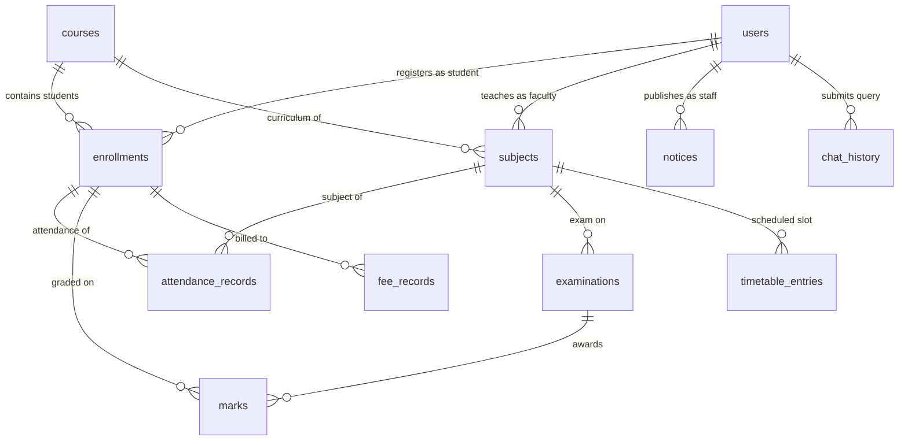

# CSIC — Basic SQL & Cloud Computing Refactoring Plan

**Author:** Senior Software Engineer  
**Date:** 2026-10-13  
**Status:** PROPOSED (Awaiting User Approval Before Destructive Schema Changes)

---

## 1. Inspection Findings & Current State Audit

### 1.1 Which Database Does the Backend Actually Use?
- **Current Reality:** The FastAPI backend currently returns data from **`InMemoryRepository`** (`backend/app/repositories/in_memory_repository.py`).
- **PostgreSQL Usage:** The existing SQL migrations (`database/migrations/001_initial_schema.sql` through `004_rls_policies.sql`) were written as static files and tested in SQLite (`database/test_schema.py`), but the backend services were **never connected to execute real SQL queries**.
- **Student Data Source:** Currently, all student records originate from hardcoded Python dictionaries in `backend/app/repositories/mock_data.py`.

### 1.2 Which Features Genuinely Work vs. Rely on Demo/Mock Data?
- **Authentication:** Works via real bcrypt hashing and JWT tokens on the backend, but queries the in-memory user list.
- **REST Endpoints:** Real FastAPI endpoints exist for auth, attendance, marks, fees, timetables, notices, and chat.
- **Frontend Dashboard:** Fully functional React + TypeScript UI that renders cards, tables, modals, and the chat drawer.
- **Database Layer:** Currently disconnected from actual backend SQL execution.

### 1.3 Genuinely Required Tables & Queries
Out of the 21 tables originally defined, only **11 tables** are genuinely required by the application features. The other 10 tables (`academic_years`, `departments`, `programs`, `faculty_assignments`, `class_sessions`, `documents`, `document_chunks`, `chat_sessions`, `chat_messages`, `audit_logs`) added gratuitous relational indirection without adding student-facing value.

### 1.4 Existing Cloud Configurations
- **Render (`render.yaml`):** Pinned web service configuration for FastAPI.
- **Vercel (`frontend/vercel.json`):** SPA rewrite rules and caching headers.
- **GitHub Actions (`.github/workflows/ci.yml`):** Automated CI pipeline.
- **Supabase:** Target cloud PostgreSQL database for Render backend.

---

## 2. Target 11-Table Simplified Relational Schema

### Table Definitions:

1. **`users`**
   - `id UUID PRIMARY KEY DEFAULT gen_random_uuid()` (or `TEXT` in SQLite)
   - `name VARCHAR(100) NOT NULL`
   - `email VARCHAR(150) NOT NULL UNIQUE`
   - `password_hash VARCHAR(255) NOT NULL`
   - `role VARCHAR(20) NOT NULL CHECK (role IN ('student', 'faculty', 'admin'))`
   - `created_at TIMESTAMP DEFAULT CURRENT_TIMESTAMP`

2. **`courses`**
   - `id UUID PRIMARY KEY DEFAULT gen_random_uuid()`
   - `code VARCHAR(20) NOT NULL UNIQUE` (e.g. 'BTECH-CSE')
   - `name VARCHAR(150) NOT NULL` (e.g. 'Bachelor of Technology in Computer Science')
   - `department VARCHAR(100) NOT NULL` (e.g. 'Computer Science & Engineering')

3. **`subjects`**
   - `id UUID PRIMARY KEY DEFAULT gen_random_uuid()`
   - `course_id UUID NOT NULL REFERENCES courses(id) ON DELETE CASCADE`
   - `code VARCHAR(20) NOT NULL UNIQUE` (e.g. 'CS501')
   - `name VARCHAR(150) NOT NULL` (e.g. 'Cloud Computing')
   - `semester INT NOT NULL CHECK (semester BETWEEN 1 AND 8)`
   - `faculty_id UUID REFERENCES users(id) ON DELETE SET NULL`

4. **`enrollments`**
   - `id UUID PRIMARY KEY DEFAULT gen_random_uuid()`
   - `user_id UUID NOT NULL REFERENCES users(id) ON DELETE CASCADE`
   - `course_id UUID NOT NULL REFERENCES courses(id) ON DELETE RESTRICT`
   - `roll_number VARCHAR(30) NOT NULL UNIQUE` (e.g. '2023CSE001')
   - `semester INT NOT NULL DEFAULT 6`
   - `status VARCHAR(20) NOT NULL DEFAULT 'active' CHECK (status IN ('active', 'completed', 'dropped'))`
   - `UNIQUE(user_id, course_id)`

5. **`attendance_records`**
   - `id UUID PRIMARY KEY DEFAULT gen_random_uuid()`
   - `enrollment_id UUID NOT NULL REFERENCES enrollments(id) ON DELETE CASCADE`
   - `subject_id UUID NOT NULL REFERENCES subjects(id) ON DELETE CASCADE`
   - `session_date DATE NOT NULL`
   - `status VARCHAR(20) NOT NULL CHECK (status IN ('present', 'absent', 'excused'))`
   - `UNIQUE(enrollment_id, subject_id, session_date)`

6. **`examinations`**
   - `id UUID PRIMARY KEY DEFAULT gen_random_uuid()`
   - `subject_id UUID NOT NULL REFERENCES subjects(id) ON DELETE CASCADE`
   - `name VARCHAR(100) NOT NULL` (e.g. 'Mid-Term Examination')
   - `exam_date DATE NOT NULL`
   - `max_marks NUMERIC(5,2) NOT NULL CHECK (max_marks > 0)`

7. **`marks`**
   - `id UUID PRIMARY KEY DEFAULT gen_random_uuid()`
   - `examination_id UUID NOT NULL REFERENCES examinations(id) ON DELETE CASCADE`
   - `enrollment_id UUID NOT NULL REFERENCES enrollments(id) ON DELETE CASCADE`
   - `marks_obtained NUMERIC(5,2) NOT NULL CHECK (marks_obtained >= 0)`
   - `is_absent BOOLEAN NOT NULL DEFAULT FALSE`
   - `UNIQUE(examination_id, enrollment_id)`

8. **`fee_records`**
   - `id UUID PRIMARY KEY DEFAULT gen_random_uuid()`
   - `enrollment_id UUID NOT NULL REFERENCES enrollments(id) ON DELETE CASCADE`
   - `title VARCHAR(150) NOT NULL` (e.g. 'Semester 6 Tuition Fee')
   - `amount NUMERIC(10,2) NOT NULL CHECK (amount > 0)`
   - `amount_paid NUMERIC(10,2) NOT NULL DEFAULT 0.00`
   - `due_date DATE NOT NULL`
   - `status VARCHAR(20) NOT NULL DEFAULT 'unpaid' CHECK (status IN ('unpaid', 'partial', 'paid'))`

9. **`timetable_entries`**
   - `id UUID PRIMARY KEY DEFAULT gen_random_uuid()`
   - `subject_id UUID NOT NULL REFERENCES subjects(id) ON DELETE CASCADE`
   - `day_of_week VARCHAR(15) NOT NULL CHECK (day_of_week IN ('Monday', 'Tuesday', 'Wednesday', 'Thursday', 'Friday', 'Saturday'))`
   - `start_time TIME NOT NULL`
   - `end_time TIME NOT NULL`
   - `room_number VARCHAR(50) NOT NULL`

10. **`notices`**
    - `id UUID PRIMARY KEY DEFAULT gen_random_uuid()`
    - `title VARCHAR(200) NOT NULL`
    - `content TEXT NOT NULL`
    - `category VARCHAR(50) NOT NULL CHECK (category IN ('academic', 'exam', 'fees', 'event', 'urgent'))`
    - `target_role VARCHAR(20) NOT NULL DEFAULT 'all' CHECK (target_role IN ('all', 'student', 'faculty'))`
    - `published_by UUID REFERENCES users(id) ON DELETE SET NULL`
    - `published_at TIMESTAMP DEFAULT CURRENT_TIMESTAMP`

11. **`chat_history`**
    - `id UUID PRIMARY KEY DEFAULT gen_random_uuid()`
    - `user_id UUID NOT NULL REFERENCES users(id) ON DELETE CASCADE`
    - `message TEXT NOT NULL`
    - `reply TEXT NOT NULL`
    - `intent VARCHAR(50) NOT NULL`
    - `created_at TIMESTAMP DEFAULT CURRENT_TIMESTAMP`

---

## 3. Mapping: Existing (21 Tables) -> Target (11 Tables)

| Existing Table | Target Table | Transformation Strategy |
| :--- | :--- | :--- |
| `profiles` + `auth.users` | `users` | Consolidated into a single, clean table with `password_hash`. |
| `departments` + `programs` + `courses` | `courses` | `department` becomes a descriptive column in `courses`. No multi-table traversal. |
| `academic_years` + `semesters` | *Eliminated* | Semester number (`INT`) is stored directly on `subjects` and `enrollments`. |
| `faculty_assignments` | *Eliminated* | `faculty_id` is a direct foreign key on `subjects`. |
| `class_sessions` | *Eliminated* | `session_date` is stored directly on `attendance_records`. Simple 1-record lookup! |
| `attendance_records` | `attendance_records` | Links directly to `enrollment_id` and `subject_id`. |
| `examinations` | `examinations` | Links directly to `subject_id`. |
| `marks` | `marks` | Links to `examination_id` and `enrollment_id`. |
| `fee_invoices` + `fee_payments` | `fee_records` | Consolidated into a single ledger: `amount`, `amount_paid`, `status`. No split payment joins. |
| `timetable_entries` | `timetable_entries` | Links directly to `subject_id`. |
| `notices` | `notices` | Preserved with simple author link. |
| `documents` + `document_chunks` | *Eliminated* | Replaced by direct FAQ policy lookup or AI interpreted policy prompts. No vector indexes! |
| `chat_sessions` + `chat_messages` | `chat_history` | Consolidated into a single message table per user. |
| `audit_logs` | *Eliminated* | Removed to simplify undergraduate project scope. |

---

## 4. Real SQL Repository Implementation Strategy

### 4.1 Real SQL Execution (Zero Mock Data)
We will introduce `backend/app/repositories/sql_repository.py`:
- Implements a unified SQL executor using standard Python `sqlite3` for local zero-configuration execution (database file `database/csic.db`) AND PostgreSQL (`psycopg2` / `asyncpg`) when `DATABASE_URL` is set in `.env` (Supabase).
- Every repository method executes **real, parameterized SQL queries**:
  - `SELECT ... FROM enrollments e JOIN subjects s ... WHERE e.user_id = ?`
  - `INSERT INTO attendance_records (...) VALUES (?, ?, ?, ?)`
  - `UPDATE fee_records SET amount_paid = ... WHERE id = ?`
- **Zero in-memory mock dictionary masquerading as a database.**

### 4.2 Streamlined Chatbot (Intent-to-SQL Pipeline)
- Chatbot classifies intent into 5 clear categories:
  1. `attendance` -> runs `SELECT subject, attended, total, percentage FROM ...`
  2. `marks` -> runs `SELECT exam, subject, marks_obtained, max_marks FROM ...`
  3. `fees` -> runs `SELECT title, amount, amount_paid, due_date FROM ...`
  4. `timetable` -> runs `SELECT subject, day, start_time, room FROM ...`
  5. `notices` -> runs `SELECT title, content, published_at FROM notices ...`
- If Gemini API key is present: Gemini generates a friendly conversational wrapper around the factual SQL result.
- If Gemini API key is absent: Formats clear text directly from the SQL query results with `[Direct Database Mode]` tag.
- Stores every conversation turn in `chat_history` via `INSERT INTO chat_history (...)`.
- **Zero arbitrary SQL generated by LLM.**

---

## 5. Migration & Safety Plan

1. **Step 1 (Plan Approval):** Get explicit approval on this document.
2. **Step 2 (Single Clean Migration):** Write `database/migrations/001_simple_schema.sql` and `database/migrations/002_seed_data.sql` implementing the 11 tables.
3. **Step 3 (Real SQL Repository):** Build `backend/app/repositories/sql_repository.py` and connect all backend domain services to execute real SQL.
4. **Step 4 (Chatbot Simplification):** Update `chatbot_service.py` to query the SQL repository directly.
5. **Step 5 (Verification & Testing):** Execute test suites against SQLite and PostgreSQL, verify frontend builds, and update `docs/sql/basic-sql-guide.md`.
